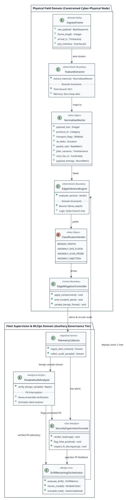

# Chapter 1: System Concept & Domain Ontology

---

## 1.1 Executive Vision & Product Taxonomy

The proliferation of connected sensing and actuation nodes across industrial automation, smart energy grids, and telecommunications infrastructure has fundamentally altered the threat landscape of cyber-physical systems (CPS). At the physical perimeter of these infrastructures lie millions of deeply resource-constrained microcontrollers (MCUs)—such as ARM Cortex-M and ultra-low-power RISC-V architectures—operating either on bare-metal loops or under deterministic Real-Time Operating Systems (RTOS). While these edge nodes execute safety-critical control loops and fieldbus translations, they remain historically devoid of onboard runtime security primitives due to stringent memory, power, and real-time execution constraints.

**MicroShield** addresses this architectural vulnerability by introducing a **Deterministic Ultra-Low-Power Embedded C Intrusion Detection System (IDS)**. Rather than adapting heavyweight enterprise security appliances or computationally opaque neural networks to constrained targets, MicroShield is conceived primarily as a **hardware-agnostic, ANSI C99-compliant static software library** engineered for direct integration into embedded firmware.

To support the embedded core across its entire operational lifecycle without burdening the microcontroller with training or storage overhead, the library is complemented by an **auxiliary Python MLOps Governance and Fleet Supervision Suite**. Consequently, from a software engineering taxonomy standpoint, the complete MicroShield ecosystem is classified as a **Dual-Tier Asymmetric Cyber-Physical Security Architecture** comprising:

1. **Primary Artifact — Core Embedded C99 Detection Library (`libmicroshield`):** A zero-dependency, statically allocated packet inspection and anomaly classification library executing directly on the target MCU. It enforces strict Worst-Case Execution Time (WCET) bounds (`O(tree_depth)`) and zero dynamic heap allocation (`malloc`-free), guaranteeing immunity against memory fragmentation and non-deterministic latency spikes.
2. **Auxiliary Artifact — Offline Training & C-Transpilation CLI Toolkit:** A scientific data-processing pipeline that ingests industrial network intrusion corpora (**Bot-IoT** [1] and **Edge-IIoTset** [2]), performs feature selection and hyperparameter pruning, and transpiles validated Decision Tree models into pure, branch-predictable C99 lookup structures.
3. **Auxiliary Artifact — Fleet Telemetry Daemon, Shadow Auditor & Web Console:** An out-of-band supervision service and interactive graphical dashboard that ingests real-time incident alerts and circular traffic samples over isolated serial links (UART), unmasks evasive False Negatives via heavy ensemble verification, monitors statistical concept drift, and orchestrates closed-loop model retraining.

| Architectural Dimension | Enterprise Network IDS (e.g., Snort, Suricata, Zeek) | Deep Edge TinyML IDS (e.g., TFLite Micro, CMSIS-NN) | Host-Based Linux Security Agents | **MicroShield Core Library (`libmicroshield`)** |
| :--- | :--- | :--- | :--- | :--- |
| **Primary Product Form** | Monolithic network appliance / daemon | Quantized neural runtime interpreter | OS-level background service | **Zero-dependency C99 static library** |
| **Target Hardware Tier** | Multi-core x86/ARM64 servers (GBs RAM) | High-end MCUs / NPUs (Hundreds KB SRAM) | Embedded Linux Gateways (Cortex-A, MMU) | **Ultra-constrained MCUs (Cortex-M, Bare-Metal/RTOS)** |
| **Memory Allocation Model** | Dynamic heap allocation & garbage collection | Static tensor arena + runtime scratchpads | Virtual memory paging & dynamic heap | **Strictly static compile-time footprint (Zero `malloc`)** |
| **Execution Time Bound (WCET)** | Non-deterministic (regex/state-table explosion) | High latency (`O(layers * neurons^2)` MACs) | Preemptible OS scheduling jitter | **Strictly deterministic `O(tree_depth)` comparisons** |
| **Explainability (XAI)** | Rule-signature match (blind to zero-day drift) | Black-box activation weights (non-auditable) | System-call heuristic logs | **Intrinsic White-Box Boolean decision path** |
| **False Negative (FN) Recovery** | Manual signature database updates | Full offline neural retraining | Cloud threat-intelligence sync | **Asymmetric Shadow Auditing & closed-loop transpilation** |

*Table 1.1: Architectural taxonomy and comparative positioning of MicroShield against established intrusion detection paradigms.*

---

## 1.2 Cyber-Physical Threat Landscape & Regulatory Mandate

### 1.2.1 The Embedded Perimeter Vulnerability
Modern Industrial Internet of Things (IIoT) and telecommunications field deployments rely heavily on hierarchical topologies where edge microcontrollers interface directly with physical transducers and actuators while communicating upstream via serial fieldbuses (UART, RS-485, CAN) or lightweight IP stacks (lwIP, uIP). Once an adversary breaches the outer perimeter or compromises a local wireless link, field MCUs are exposed to four primary classes of network-borne attacks:

* **Volumetric and Protocol Denial of Service (DoS/DDoS):** High-frequency packet floods (SYN floods, UDP storms, or serial frame saturation) designed to exhaust interrupt service routines (ISRs), starve RTOS task schedulers, or trigger watchdog resets.
* **Network Reconnaissance and Topology Probing:** Systematic port scanning, address sweeping, and malformed protocol handshakes aimed at fingerprinting firmware versions and discovering unauthenticated command registers.
* **Malicious Payload and Command Injection:** Insertion of crafted byte sequences, buffer-overflow exploits, or unauthorized actuation commands within legitimate protocol frames, characterized by anomalous payload length distributions and elevated Shannon entropy.
* **Adversarial Evasion and Concept Drift:** Gradual shifts in legitimate operational traffic profiles (due to seasonal industrial workloads or topology changes) or deliberate slow-rate adversarial mutations engineered to slip beneath static threshold filters.

### 1.2.2 European and International Regulatory Drivers
Historically, embedded device manufacturers treated field-level cybersecurity as an optional post-deployment feature. However, recent binding legislative frameworks in the European Union and international industrial standards have elevated embedded runtime anomaly detection to a mandatory legal requirement for market access:

* **EU Cyber Resilience Act (CRA — Regulation (EU) 2024/2847) [3]:** Mandates that all *products with digital elements* placed on the European market be designed with security-by-default architectures (Annex I, Part I). Specifically, the CRA requires embedded systems to protect the availability of essential functions against Denial of Service attacks, monitor internal security states, and provide automated mechanisms for vulnerability remediation and security updates throughout the product lifecycle.
* **NIS 2 Directive (Directive (EU) 2022/2555) [4]:** Enforces strict supervisory and incident-reporting obligations (Article 21 and Article 23) across critical sectors (energy, transport, digital infrastructure, manufacturing). Organizations must implement continuous anomaly monitoring, rapid containment of compromised operational technology (OT) nodes, and documented audit trails within 24 hours of incident awareness.
* **IEC 62443-4-2 (Security for Industrial Automation and Control Systems) [5]:** Defines technical component-level requirements (CRs), specifically mandating **Resource Availability (CR 7.1)** against DoS degradation, **Continuous Monitoring (CR 6.2)** of security events at the device boundary, and **Deterministic Safety Preservation** ensuring that security controls never jeopardize physical real-time actuation deadlines.

| Regulatory Standard / Clause | Core Mandate | MicroShield Architectural Realization |
| :--- | :--- | :--- |
| **EU CRA (Annex I, Part I, §1)** | Security-by-design and protection against unauthorized access and payload corruption. | Inline `O(1)` feature extraction and `O(tree_depth)` classification of every ingress frame prior to application-layer parsing. |
| **EU CRA (Annex I, Part I, §3(f))** | Resilience of essential functions and mitigation of Denial of Service (DoS) effects. | Deterministic execution bounds and hardware-level FSM quarantine (`EdgeMitigationController`) isolating flooded interfaces. |
| **EU CRA (Annex I, Part II)** | Continuous vulnerability handling and field updateability across the support period. | Closed-loop MLOps pipeline capable of transpiling and deploying updated Decision Tree logic as drift emerges. |
| **NIS 2 Directive (Article 21.2)** | Incident detection, operational continuity, and supply-chain cyber hygiene. | Out-of-band UART telemetry streaming structured explainable alerts (`ClassificationVerdict` + feature vector) to SecOps consoles. |
| **IEC 62443-4-2 (CR 6.1 & CR 7.1)** | Audit log accessibility and deterministic resource protection on embedded components. | Zero-heap static memory allocation preventing memory exhaustion, paired with white-box XAI decision path traceability. |

*Table 1.2: Mapping of binding regulatory and industrial security mandates to MicroShield core capabilities.*

---

## 1.3 Domain Ontology & Operational Mechanics

To maintain strict separation of concerns between hard real-time embedded execution and high-capacity analytical governance, the MicroShield domain ontology is partitioned into two distinct Bounded Contexts: the **Physical Field Domain** and the **Fleet Supervision & MLOps Domain**.

*(Click on the diagram to open the full-resolution vector graphic)*
*Figure 1.1: Domain-Driven Design (DDD) ontology of the MicroShield architecture, illustrating the deterministic edge inspection boundary and the closed-loop MLOps shadow auditing lifecycle.*

### 1.3.1 Physical Field Domain (Constrained Cyber-Physical Node)
The Physical Field Domain encapsulates the pure C99 runtime environment executing on the microcontroller. Every incoming communication unit is modeled as an `IngressFrame` entity carrying raw byte sequences, arrival timestamps, and physical interface identifiers.

1. **Constant-Time Feature Extraction (`FeatureExtractor`):** Rather than buffering entire multi-packet sessions—which would introduce unbounded memory growth—the extractor computes a compact, fixed-size `NormalizedVector` in strictly constant time (`O(1)`) using circular sliding registers and incremental bit-level arithmetic. The vector captures eight orthogonal physical and statistical telemetry dimensions:
   * *Structural Header Metrics:* `payload_size`, `protocol_id`, and `transport_flags`.
   * *Temporal & Volumetric Dynamics:* `iat_delta` (inter-arrival time delta), `packet_rate` over the active sliding window, and `jitter_variance` (temporal dispersion).
   * *Topological & Information-Theoretic Metrics:* `conn_fan_in` (source dispersion cardinality) and `payload_entropy` (normalized Shannon byte entropy to detect encrypted shells or binary exploit sleds).
2. **Deterministic Tree Inference (`EdgeInferenceEngine`):** The normalized vector is evaluated by a transpiled Decision Tree [6]. Unlike neural classifiers requiring floating-point matrix multiplications, a Decision Tree of maximum depth `D` executes at most `D` scalar threshold comparisons. This guarantees a hard, mathematically provable worst-case execution time of `O(tree_depth)` using purely static branching logic.
3. **Autonomous Containment (`EdgeMitigationController`):** Upon yielding a `ClassificationVerdict` (`BENIGN_TRAFFIC`, `ANOMALY_DOS_FLOOD`, `ANOMALY_SCAN_PROBE`, or `ANOMALY_INJECTION`), the local mitigation finite-state machine (FSM) immediately enforces physical containment (e.g., dropping the frame, throttling the ingress interface, or asserting a hardware quarantine GPIO pin) while dispatching a compact telemetry record over a dedicated diagnostic UART channel.

### 1.3.2 Epistemology of Detection Errors: False Positives, False Negatives & Shadow Auditing
A rigorous intrusion detection treatise must confront the fundamental asymmetry between the two primary classification errors in a distributed edge environment:

* **The Visibility of False Positives (FP):** When the `EdgeInferenceEngine` misclassifies legitimate industrial traffic as an attack (`FP`), the operational impact is immediate and observable: a valid telemetry update is blocked or a node enters precautionary quarantine. A Security Operations (SecOps) analyst inspecting the `SecuritySupervisionConsole` can directly examine the white-box decision path that triggered the alert, verify the benign nature of the payload, and invoke `flag_false_positive()` to queue the misclassified vector for model correction.
* **The Epistemological Silence of False Negatives (FN):** Conversely, when a novel or mutated attack evades the decision tree and is classified as `BENIGN_TRAFFIC` (`FN`), the edge library takes no containment action and raises no alarm. If the edge node only transmitted detected anomalies to the supervision server, **False Negatives would remain permanently invisible**, rendering the system blind to evasive zero-day mutations until catastrophic physical damage occurred.
* **Resolution via Asymmetric Shadow Auditing (`ShadowAuditAnalyzer`):** To break this epistemological blindness without saturating the low-bandwidth telemetry link, MicroShield implements **Statistical Shadow Auditing**. Alongside real-time anomaly alerts, the `EdgeMitigationController` periodically extracts a non-blocking, stratified circular sample (e.g., 1 out of every `K` frames, plus boundary-adjacent benign frames that passed close to decision split thresholds) of traffic labeled `BENIGN_TRAFFIC` and transmits it over the out-of-band audit stream.
  On the host tier, the `ShadowAuditAnalyzer` evaluates these sampled vectors against computationally heavy reference ensembles—such as high-depth Random Forests, Isolation Forests, and Deep Autoencoders—that cannot fit on an MCU. When the reference ensemble identifies an attack signature within a sample that the edge classified as benign, an **unmasked False Negative discrepancy** is automatically raised on the `SecuritySupervisionConsole` and routed to the retraining pipeline.

### 1.3.3 Concept Drift Detection & Closed-Loop Retraining
Industrial networks are non-stationary environments: firmware upgrades, new sensor rollouts, and evolving attack toolkits induce **Concept Drift** (shifts in the underlying joint probability distribution `P(X, Y)` of feature vectors `X` and threat classes `Y`). 

The `DriftRetrainingOrchestrator` continuously monitors three convergence signals:
1. **Cumulative Operator FP Overrides:** The rate of manual False Positive corrections submitted via the console.
2. **Unmasked FN Discrepancy Rate:** The frequency of silent evasions caught by the `ShadowAuditAnalyzer`.
3. **Statistical Distribution Divergence:** Quantitative drift metrics—specifically the **Population Stability Index (PSI)** and two-sample **Kolmogorov-Smirnov (K-S) statistics**—computed over sliding windows of incoming telemetry relative to the baseline training distribution (**Bot-IoT** and **Edge-IIoTset**).

When any of these indicators breaches its calibrated tolerance threshold, the orchestrator merges the newly labeled FP/FN telemetry into the historical corpus, trains and prunes an updated reference Decision Tree, verifies its F1-score and depth invariants, and transpiles a new static C99 code asset ready for deterministic edge deployment.

---

## 1.4 Operational Environments, Interaction Topologies & Data Lifecycle

MicroShield operates across heterogeneous physical environments and interaction timescales, requiring a disciplined multi-tier data governance strategy that respects the volatile nature of embedded SRAM while preserving forensic auditability on the supervision tier.

| Operational Tier | Physical Deployment Location | Interacting Actors / Subsystems | Interaction Frequency & Modality | Data Stored & Persistence Policy |
| :--- | :--- | :--- | :--- | :--- |
| **Tier 1: Hard Real-Time Edge Runtime** | Industrial field cabinets, PLC backplanes, telecom base stations (MCU SRAM/Flash). | Physical network interfaces, RTOS kernel tasks, hardware timers/watchdogs. | **Continuous Wire-Speed (Microseconds):** Synchronous C99 API calls per ingress frame (`O(tree_depth)`). | **Volatile Static RAM Only:** Circular sliding-window counters (tens of bytes) and compiled read-only tree thresholds in Flash. Zero persistent user/payload storage on edge. |
| **Tier 2: Out-of-Band Telemetry & Shadow Bus** | Isolated diagnostic UART / RS-485 serial link between field MCU and local gateway. | `EdgeMitigationController` (producer) and `TelemetryCollector` daemon (consumer). | **Event-Driven & Periodic (Milliseconds to Seconds):** Asynchronous emission on attack detection + periodic circular benign sampling. | **Transient Ring Buffers:** Compact binary frames encapsulating timestamp, 8-feature vector, tree verdict, and triggered leaf ID. |
| **Tier 3: Fleet Supervision & SecOps Console** | Enterprise Security Operations Center (SOC) or plant control room (Browser / Workstation). | IoT Security Analysts, Plant Directors, and incident response teams. | **Interactive & On-Demand (Minutes to Hours):** Visual heatmap inspection, XAI path auditing, and manual FP flagging. | **Persistent Time-Series & Incident Store:** Structured audit logs (JSON/SQLite/Parquet) retained for NIS 2 forensic compliance and regulatory reporting. |
| **Tier 4: Offline MLOps & CI/CD Pipeline** | On-premise compute server or containerized cloud CI/CD runner (Docker / Poetry). | Firmware Engineers, Data Scientists, and automated `DriftRetrainingOrchestrator`. | **Batch & Threshold-Triggered (Days to Weeks):** Invoked upon statistical drift detection or scheduled release cycles. | **Versioned Benchmark & Artifact Repository:** Curated **Bot-IoT** / **Edge-IIoTset** subsets, validated FP/FN feedback matrices, and versioned `.c`/`.h` transpiled tree assets. |

*Table 1.3: Multi-tier operational topology, interaction frequency, and data persistence governance across the MicroShield ecosystem.*

---

## 1.5 Stakeholder Taxonomy & Engineering Personas

Because MicroShield bridges low-level embedded firmware engineering, operational cybersecurity analysis, and executive regulatory governance, its requirements are driven by three distinct stakeholder archetypes. Rather than generic end-users, these personas represent specialized engineering and leadership roles with rigorous, occasionally competing technical constraints.

### 1.5.1 Persona 1: Taddeo Pallabà — *Senior Embedded Firmware & RTOS Engineer*
* **Professional Profile:** 42 years old, M.Sc. in Electronic Engineering. Possesses 15 years of bare-metal and FreeRTOS firmware development experience on ARM Cortex-M4/M7 microcontrollers (such as STM32F4/H7 families) for industrial motion control and fieldbus gateways.
* **Operational Context & Pain Points:** Taddeo manages firmware where every kilobyte of SRAM and every microsecond of interrupt latency is strictly budgeted. He distrusts third-party security libraries that introduce external dependencies, dynamic memory allocation (`malloc`/`free`), or unpredictable execution loops that could starve critical motor-control timers and trigger hardware watchdog resets.
* **Core Expectations from MicroShield:**
  * A clean, self-contained **ANSI C99 API** (`microshield_init()`, `microshield_evaluate()`) that compiles cleanly under `-Wall -Wextra -Werror -pedantic` without external OS dependencies.
  * **Strict Determinism & Zero Heap Usage:** Mathematical guarantee that packet evaluation completes within a fixed number of CPU clock cycles (`O(tree_depth)`) using exclusively stack or static BSS memory.
  * **Automated Cross-Compilation & Verification:** Containerized CI/CD pipelines that automatically verify memory footprints and unit tests before any transpiled tree update touches his firmware repository.

### 1.5.2 Persona 2: Lentina Gigi — *Industrial IoT Security Operations (SecOps) Analyst*
* **Professional Profile:** 31 years old, M.Sc. in Cybersecurity. Leads threat monitoring inside a converged IT/OT Security Operations Center overseeing thousands of distributed field sensors and telecommunications relay nodes.
* **Operational Context & Pain Points:** Lentina is overwhelmed by alert fatigue caused by opaque anomaly detectors that output unintelligible probability scores (e.g., *"Anomaly Score: 0.87"*) without explaining *why* a frame was blocked. Furthermore, she is acutely aware that resource-constrained edge rules can suffer from silent False Negatives when attackers slightly mutate packet rates or payload padding.
* **Core Expectations from MicroShield:**
  * **Intrinsic Explainable AI (XAI):** Every alert on her supervision console must expose the exact boolean decision path traversed in the C tree (e.g., `iat_delta <= 120us AND payload_entropy > 0.82 -> ANOMALY_DOS_FLOOD`).
  * **Actionable False Positive Mitigation:** A streamlined workflow to flag False Positives directly from the live telemetry stream when legitimate burst traffic is misclassified.
  * **Automated False Negative Discovery:** Visibility into **Shadow Audit Discrepancy Reports**, allowing her to see when the server-side ensemble catches evasive attacks that slipped past the edge MCU, and to trigger closed-loop model retraining with a single command.

### 1.5.3 Persona 3: Zanni Giorgioni — *Chief Digital Officer (CDO) & Plant Operations Director*
* **Professional Profile:** 54 years old, M.Sc. in Industrial Engineering & MBA. Accountable for plant-wide operational availability, capital expenditure (CapEx), and legal compliance with European cybersecurity directives across multiple production facilities.
* **Operational Context & Pain Points:** Zanni faces strict deadlines to bring legacy industrial installations into compliance with the **EU Cyber Resilience Act (CRA)** and **NIS 2 Directive**. Replacing thousands of deployed microcontrollers with expensive Linux-capable edge gateways is financially prohibitive, yet a single successful ransomware or DoS outage on the factory floor costs tens of thousands of euros per hour in halted production.
* **Core Expectations from MicroShield:**
  * **Zero-CapEx Legacy Retrofitting:** The ability to deploy enterprise-grade intrusion detection via a lightweight firmware update onto existing low-cost microcontrollers.
  * **Autonomous Fault Containment:** Immediate, localized quarantine of compromised edge nodes to prevent lateral threat propagation across the plant network without requiring human latency.
  * **Auditable Regulatory Compliance:** Exportable incident timelines, drift stability metrics, and vulnerability handling logs demonstrating full due diligence under EU CRA and NIS 2 audits.

| Persona & Role | Primary Technical Domain | Non-Negotiable System Invariant | Primary Interface with MicroShield | Key Performance Indicator (KPI) |
| :--- | :--- | :--- | :--- | :--- |
| **Taddeo Pallabà** (*Embedded Firmware Engineer*) | Physical Field Domain (C99 / MCU / RTOS) | Zero dynamic allocation (`malloc`-free) & hard `O(tree_depth)` WCET bound. | C99 header/source library (`libmicroshield`) & transpiled static tree headers. | Worst-case CPU cycle count per frame & static Flash/SRAM byte footprint. |
| **Lentina Gigi** (*IoT SecOps Analyst*) | Fleet Supervision & MLOps Domain (SOC / Analytics) | White-box XAI rule traceability & Shadow Audit interception of silent False Negatives. | Interactive `SecuritySupervisionConsole` & `DriftRetrainingOrchestrator` CLI. | Macro F1-score, False Positive Rate (FPR), and Mean Time to Detect (MTTD) drift. |
| **Zanni Giorgioni** (*CDO & Plant Director*) | Executive Governance & Regulatory Compliance | Operational continuity (Zero unplanned downtime) & EU CRA / NIS 2 alignment. | Executive risk heatmaps, quarantine status boards, and compliance audit reports. | Fleet availability percentage, regulatory audit pass rate, and avoided CapEx. |

*Table 1.4: Synthesis of stakeholder personas, domain invariants, system interfaces, and validation KPIs.*

---

## 1.6 References & Normative Bibliography

1. **Koroniotis, N., Moustafa, N., Sitnikova, E., & Turnbull, B.** (2019). *Towards the development of realistic botnet dataset in the Internet of Things for network forensic analytics: Bot-IoT dataset*. Future Generation Computer Systems, 100, 779–796. DOI: `10.1016/j.future.2019.05.041`.
2. **Ferrag, M. A., Friha, O., Hamouda, D., Maglaras, L., & Janicke, H.** (2022). *Edge-IIoTset: A New Comprehensive Realistic Cyber Security Dataset of IoT and IIoT Applications for Centralized and Federated Learning*. IEEE Access, 10, 40281–40306. DOI: `10.1109/ACCESS.2022.3165809`.
3. **European Parliament and Council of the European Union** (2024). *Regulation (EU) 2024/2847 on horizontal cybersecurity requirements for products with digital elements (Cyber Resilience Act)*. Official Journal of the European Union, L series.
4. **European Parliament and Council of the European Union** (2022). *Directive (EU) 2022/2555 on measures for a high common level of cybersecurity across the Union (NIS 2 Directive)*. Official Journal of the European Union, L 333/80.
5. **International Electrotechnical Commission (IEC)** (2019). *IEC 62443-4-2: Security for industrial automation and control systems — Part 4-2: Technical security requirements for IACS components*. Geneva, Switzerland.
6. **Breiman, L., Friedman, J., Stone, C. J., & Olshen, R. A.** (1984). *Classification and Regression Trees (CART)*. Chapman and Hall/CRC.
