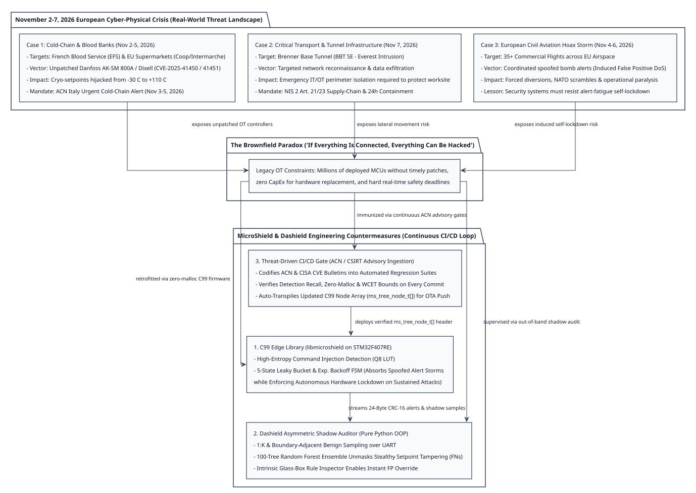
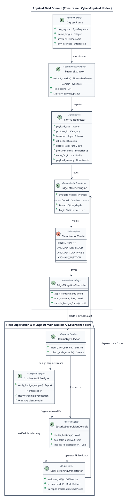

# Chapter 1: System Concept, Threat Landscape & Domain Ontology

---

## 1.1 Executive Vision & Product Taxonomy

The pervasive deployment of connected sensing, refrigeration, and actuation nodes across industrial Operational Technology (OT), healthcare supply chains, smart grid infrastructures, and transportation networks has fundamentally expanded the cyber-physical attack surface. At the foundation of this modernization lies an acute structural vulnerability: while organizations connect field apparatus to IP networks and fieldbuses, resource-constrained field controllers rarely receive software updates, creating a persistent brownfield exposure gap.

At the physical perimeter of these operational networks, microcontrollers (such as ARM Cortex-M and ultra-low-power RISC-V devices) run bare-metal control loops or lightweight Real-Time Operating Systems (RTOS). These units execute time-critical physical tasks, thermal regulation, and protocol conversions without hardware memory protection units (MMUs) or onboard intrusion detection primitives.

**MicroShield** introduces an inline security architecture specifically tailored to these constrained execution environments through a **Deterministic Ultra-Low-Power Embedded C Intrusion Detection System (IDS)**. Rather than attempting to scale down heavyweight enterprise detection frameworks or deploying resource-intensive neural networks, MicroShield is structured as a **hardware-agnostic, ANSI C99 static library (`libmicroshield`)** engineered for direct firmware integration.

To maintain the operational integrity of the microcontroller without burdening the physical device with model training, telemetry storage, or high-level governance, the core embedded engine operates in symbiosis with **`Dashield`**, an **auxiliary Pure-Python Fleet Supervision, Shadow Auditing, and MLOps Suite**. The overall ecosystem establishes an **Asymmetric Dual-Tier Cyber-Physical Security Architecture**:

1. **Primary Artifact — Core Embedded C99 Detection Library (`libmicroshield`):** A zero-dependency, statically allocated frame inspection and autonomous containment library deployed on the target MCU. It guarantees deterministic execution bounds with worst-case execution time bounded by tree depth (`O(tree_depth)`), operates strictly through fixed-point integer arithmetic (`Q8`), and adheres to a zero dynamic heap allocation model (`malloc`-free) to eliminate runtime fragmentation and latency nondeterminism.
2. **Auxiliary Artifact — MLOps Pipeline & C Transpilation Toolkit:** An analytical processing pipeline that ingests established industrial benchmark corpora (**Bot-IoT** and **Edge-IIoTset**) alongside machine-readable national cybersecurity agency threat descriptors. It conducts feature selection, performs depth-constrained optimization, and transpiles validated Decision Tree models into immutable, branch-predictable C99 node arrays (`ms_tree_node_t[]`).
3. **Auxiliary Artifact — `Dashield` Fleet Telemetry Daemon, Shadow Auditor & Console:** An out-of-band supervision service that captures real-time diagnostic alerts and circular traffic samples over dedicated serial channels (UART). It detects silent False Negatives through higher-capacity reference ensemble verification, monitors statistical concept drift, models industrial threat profiles, and coordinates retraining cycles.

| Architectural Dimension | Enterprise Network IDS (Snort, Suricata, Zeek) | Deep Edge TinyML Frameworks (TFLite Micro) | Host-Based OS Security Agents | **MicroShield Core (`libmicroshield`) + `Dashield`** |
| :--- | :--- | :--- | :--- | :--- |
| **Primary Form Factor** | Monolithic server application / daemon | Quantized neural runtime interpreter | OS-level kernel/user daemon | **Zero-dependency C99 static library + Python MLOps suite** |
| **Target Hardware Tier** | Multi-core x86/ARM64 servers (Gigabytes RAM) | High-end microcontrollers (Hundreds KB SRAM) | Embedded Linux Gateways (Cortex-A, MMU) | **Resource-constrained MCUs (Cortex-M4F, Bare-Metal/RTOS)** |
| **Memory Allocation** | Dynamic heap allocation & garbage collection | Static tensor arena + execution scratchpad | Virtual memory paging & dynamic heap | **Strictly static compile-time footprint (`0 Bytes` heap `malloc`)** |
| **Worst-Case Latency** | Non-deterministic state-table parsing | High execution latency (Matrix operations) | Preemptible OS scheduling jitter | **Strictly deterministic `O(tree_depth)` integer comparisons** |
| **Model Interpretability** | Rule-signature matching (rigid thresholds) | Black-box weights (post-hoc explanation required) | System-call trace heuristics | **Intrinsic Ante-Hoc Glass-Box Decision Paths (Rudin, 2019)** |
| **False Negative Handling** | Signature updates pushed post-breach | Periodic offline retraining | Central threat-intel synchronizations | **Asymmetric Shadow Auditing & Threat-Driven CI/CD Verification** |

*Table 1.1: Comparative architectural classification of MicroShield against conventional detection approaches.*

---

## 1.2 Cyber-Physical Threat Landscape, The November 2026 Crisis & Continuous Threat-Driven Integration

### 1.2.1 Physical Layer Vulnerabilities & Cyber-Physical Threat Dynamics
Industrial Internet of Things (IIoT), healthcare cold-chain logistics, and transport automation topologies connect edge microcontrollers directly to physical actuators (compressors, switches, valves) while routing operational data over serial fieldbuses (RS-485, Modbus) or lightweight network stacks. As established in the seminal cyber-physical security literature by Cárdenas et al. (2011) and Urbina et al. (2016), once an attacker gains ingress to an industrial network perimeter, edge devices become susceptible to four primary attack classes:

* **Volumetric & Protocol Denial of Service (DoS/DDoS):** High-throughput frame floods targeted at saturating Interrupt Service Routines (ISRs) and exhausting real-time scheduling allocations.
* **Network Reconnaissance & Lateral Sweeping:** Systematic bus probing and Modbus/TCP register scans designed to enumerate field controllers and locate unauthenticated interfaces.
* **Command Injection & Semantic Setpoint Tampering:** Arbitrary payload injection or manipulation of physical setpoint thresholds within control commands, altering process behavior without disrupting basic framing integrity.
* **Induced Alert Storms & Evasion Dynamics:** Exploiting naive threshold monitors by generating synthetic boundary traffic to provoke self-lockdowns, or pacing attacks slowly to slip under edge heuristics.

### 1.2.2 The November 2026 European Cyber-Physical Incidents
The operational vulnerability of connected brownfield controllers transitioned from theoretical modeling to widespread disruption during the incidents across Europe in early November 2026:

1. **Refrigeration & Healthcare Cold-Chain Sabotage (November 2–5, 2026):**
   Automated campaigns targeted connected commercial refrigeration systems and biological storage centers across France (affecting regional distribution hubs of the *Établissement Français du Sang* — EFS) and commercial networks in Italy, Belgium, and Sweden. Attackers targeted exposed industrial refrigeration units (specifically Danfoss AK-SM 800A and Dixell platforms vulnerable to authentication bypass and remote command injection under `CVE-2025-41450` and `CVE-2025-41451`). By overriding temperature setpoints—attempting shifts from critical storage temperatures of `-30 °C` up to extreme positive values—the campaign demonstrated the critical vulnerability of physical inventory to unauthorized remote commands. Following these disruptions, national cybersecurity authorities, including the Italian National Cybersecurity Agency (ACN / CSIRT Italia), issued urgent advisories stressing that unpatched industrial controllers exposed on tele-maintenance interfaces represent an active systemic hazard.
2. **Alpine Transport Infrastructure Perimeter Defense (November 7, 2026):**
   The Austro-Italian joint entity BBT SE, overseeing the construction and engineering of the Brenner Base Tunnel, reported a cyber intrusion targeting administrative systems, necessitating immediate network isolation of engineering perimeters to ensure that operational systems managing worksite ventilation and drainage remained physically segregated and protected.
3. **Induced Operational Paralysis via Spoofed Warning Waves (November 4–6, 2026):**
   Dozens of commercial flights across European airspace were diverted or grounded due to coordinated false threat alerts. In systems engineering terms, this campaign illustrates an asymmetric Denial of Service driven by forced false positives: inducing security monitors to execute safety quarantines and shutdowns without introducing a functional kinetic payload.

  
*(Click on the diagram to open the full-resolution vector graphic)*  
*Figure 1.1: Structural mapping of the early November 2026 cyber-physical incidents and agency advisories to the MicroShield dual-tier countermeasure pipeline.*

| Operational Incident | Target Profile & Exploit Vector | Failure Mode in Legacy Deployments | MicroShield Defense Strategy |
| :--- | :--- | :--- | :--- |
| **Cold-Chain & Biological Storage** *(Nov 2–5, 2026)* | Industrial cooling controllers; Command Injection (`CVE-2025-41451`) altering thermal setpoints. | **The Unpatched Edge Gap:** Legacy controllers remain unpatched due to operational uptime requirements and lack of runtime inspection. | **Zero-CapEx Inline Inspection & Shadow Auditing:** High-entropy payloads are halted inline (`O(depth)`), while stealthy tampering attempts are captured via out-of-band ensemble auditing. |
| **Strategic Transport Infrastructure** *(Nov 7, 2026)* | Reconnaissance sweeps and risk of lateral movement into critical control networks (BBT SE). | **Lateral Movement Propagation:** Peripheral network breaches threaten operational technology when gateways lack local quarantine. | **Deterministic Escalation FSM:** Sustained scanning probes trigger local hardware interface isolation (`LOCKDOWN_L3`), severing lateral infiltration. |
| **Civil Transport Alert Storms** *(Nov 4–6, 2026)* | Coordinated spoofed threat notifications designed to trigger precautionary shutoffs. | **Induced Operational Stoppage:** Binary detection triggers cause costly self-inflicted shutdowns upon encountering transient anomalies. | **5-State Leaky Bucket Filtering:** Sporadic anomalies drop individual frames without closing interfaces, backed by glass-box decision path transparency. |

*Table 1.2: Technical categorization of the November 2026 cyber-physical disruptions and corresponding architectural defenses.*

---

### 1.2.3 European Regulatory Directives & Threat-Driven CI/CD Integration
European regulatory standards mandate formal technical controls for connected operational technology:

* **EU Cyber Resilience Act (CRA — Regulation (EU) 2024/2847):** Mandates cybersecurity by design across digital products (Annex I, Part I), requiring resilience against Denial of Service, internal health monitoring, minimal third-party software dependencies, and verified update pathways.
* **NIS 2 Directive (Directive (EU) 2022/2555) & National Transposition:** Establishes rigorous monitoring and 24-hour early-warning reporting obligations for critical infrastructure operators across healthcare, essential food distribution, and transport sectors.
* **IEC 62443-4-2:** Specifies industrial component-level criteria, including Resource Availability (CR 7.1) and continuous boundary event monitoring (CR 6.2).
* **Continuous Threat-Driven Integration:** MicroShield integrates published vulnerability bulletins directly into its software quality assurance lifecycle. Threat descriptors derived from agency advisories are versioned as structured regression suites. On every automated build, test pipelines evaluate the C99 library and Python Shadow Auditor against these attack models, ensuring that detection performance and deterministic execution bounds are maintained before deploying updated decision trees.

---

## 1.3 Domain Ontology & Operational Mechanics

The MicroShield domain ontology is structured into two formal Bounded Contexts: the **Physical Field Domain** and the **Fleet Supervision & MLOps Domain**.

  
*(Click on the diagram to open the full-resolution vector graphic)*  
*Figure 1.2: Domain-Driven Design (DDD) ontology of MicroShield, illustrating the deterministic inspection boundary and closed-loop telemetry lifecycle.*

### 1.3.1 Physical Field Domain (Constrained Cyber-Physical Node)
The Physical Field Domain models the runtime execution environment on the target microcontroller. Ingress network data is handled as discrete `IngressFrame` entities comprising raw payload references, frame lengths, arrival timestamps, and interface identifiers.

1. **Constant-Time Feature Extraction (`FeatureExtractor`):** To avoid buffering multi-frame sessions in memory, the engine updates a fixed-size `NormalizedVector` in strictly constant time (`O(1)`) using sliding accumulators and fixed-point integer arithmetic (`Q8`). The extracted vector encodes eight physical and statistical dimensions:
   * *Structural Header Fields:* `payload_size`, `protocol_id`, and `transport_flags`.
   * *Temporal Dynamics:* `iat_delta` (inter-arrival time), sliding-window packet throughput, and arrival jitter variance.
   * *Information-Theoretic Attributes:* source connection cardinality (`conn_fan_in`) and normalized Shannon byte entropy (`payload_entropy_q8`), computed via a Flash Look-Up Table to capture binary injections and high-entropy exploits.
2. **Deterministic Glass-Box Tree Inference (`EdgeInferenceEngine`):** Extracted vectors are evaluated by a transpiled Decision Tree. In contrast to opaque models, shallow Decision Trees are intrinsically interpretable by design (Rudin, 2019). Traversal of a tree with maximum depth `D <= 8` executes at most `D` integer comparison operations, guaranteeing a strict worst-case bound of `O(tree_depth)`.
3. **Autonomous Multi-Stage Mitigation (`EdgeMitigationController`):** The output `ClassificationVerdict` drives a deterministic Finite-State Machine (FSM). Rather than relying on simple binary drop logic, the FSM provides proportional escalation across five operational levels: absorptive drops (`SUSPICIOUS`), micro-throttling (`THROTTLED_L1`), exponential backoff (`QUARANTINED_L2`), and complete hardware receiver lockdown (`LOCKDOWN_L3`).

### 1.3.2 Epistemology of Detection Errors: False Positives, False Negatives & Shadow Auditing
Edge-deployed security models exhibit fundamentally asymmetric error visibility:

* **Observable False Positives:** When legitimate industrial telemetry is misclassified as anomalous, operations are impacted immediately. In `Dashield`, analysts inspect the exact boolean path triggered (`matched_rule_id`), verify operational context, and execute an operator override that unblocks the node and records the vector for future model adjustment.
* **Silent False Negatives:** Conversely, when stealthy manipulation commands or low-rate probes bypass edge thresholds, the edge system takes no action. Left unchecked, evasive payloads remain completely undetected until physical operational disruption occurs.
* **Resolution via Asymmetric Shadow Auditing:** To intercept stealthy evasions without saturating communication links, the edge controller periodically extracts a lightweight, stratified sample (`1:K` frames plus boundary-adjacent frames that evaluated close to threshold splits) of traffic marked as benign. The `ShadowAuditAnalyzer` in `Dashield` evaluates these samples against a higher-capacity reference ensemble (100-tree Random Forest and statistical consistency verifiers). If the reference ensemble classifies a sampled frame as malicious, an unmasked discrepancy alert (`UNMASKED_FN`) is raised, alerting operators and queueing the vector for retraining.

### 1.3.3 Concept Drift Monitoring & Model Retraining
Operational conditions in industrial networks evolve due to software updates, operational load changes, and modified threat tooling, inducing statistical drift in the underlying feature distribution. 

The `DriftRetrainingOrchestrator` tracks model stability through a composite Retraining Readiness Index synthesizing three signals:
1. Accumulated operator-confirmed False Positive overrides.
2. Intercepted False Negative discrepancies identified via Shadow Auditing.
3. Distributional divergence quantified through the Population Stability Index (PSI) and Kolmogorov-Smirnov statistics computed against baseline distributions.

When the readiness index crosses its target boundary, the retraining engine integrates verified operational telemetry into baseline datasets, trains a depth-bounded Decision Tree, verifies classification invariants, and transpiles an updated static C99 node array for deployment.

---

## 1.4 Operational Environments, Topologies & Data Lifecycle

MicroShield partitions operational responsibilities across discrete physical tiers to balance deterministic edge execution with comprehensive central auditability.

| Operational Tier | Deployment Environment | Interacting Entities | Operating Cadence | Data Persistence & Boundary Policies |
| :--- | :--- | :--- | :--- | :--- |
| **Tier 1: Real-Time Edge Runtime** | Field controllers, automation cabinets, telemetry interfaces (ARM Cortex-M4F). | Network interfaces, RTOS tasks, interrupt controllers. | **Synchronous Wire-Speed (Microseconds):** Frame inspection within deterministic bounds (`O(tree_depth)`). | **Volatile Static Memory:** Sliding-window registers (`<= 128 Bytes`) and immutable Flash structures (`<= 4 KB`). Zero dynamic heap. |
| **Tier 2: Out-of-Band Telemetry Link** | Dedicated serial links (UART) or virtual container sockets. | `EdgeMitigationController` and host `TelemetryCollector`. | **Event-Driven & Periodic (Milliseconds to Seconds):** Continuous incident alerts and stratified audit samples. | **Transient Buffering:** Fixed-size 24-byte binary frames protected by CRC-16 checksums. |
| **Tier 3: Supervision & SOC Console** | Plant operations rooms and central monitoring consoles. | Security analysts, operational engineers, plant supervisors. | **Interactive / Real-Time (Seconds to Hours):** Telemetry visualization, glass-box rule inspection, and manual override. | **Persistent Storage (SQLite WAL):** Structured audit logs, discrepancy records, and compliance artifacts. |
| **Tier 4: MLOps & Verification Pipeline** | Automated CI/CD runners and local training environments. | Firmware maintainers, data engineers, automated testing tools. | **Triggered on Events / Periodic:** Executed on threat bulletin updates or detected statistical drift. | **Versioned Artifacts:** Curated reference datasets, regression suites, and compiled C99 header files. |

*Table 1.3: Distributed operational environment boundaries and data retention characteristics.*

---

## 1.5 Stakeholder Taxonomy & Engineering Personas

MicroShield is engineered to address the specific technical requirements and operational constraints of three core industrial stakeholder roles:

### 1.5.1 Persona 1: Taddeo Pallabà — *Senior Embedded Firmware & RTOS Engineer*
* **Profile:** Experienced engineer managing bare-metal and RTOS firmware across industrial controllers and fieldbus interfaces.
* **Operational Context:** Responsible for maintaining real-time control loops where available memory and interrupt response windows are tightly constrained. Avoids external dependencies, dynamic memory allocation, or non-deterministic loops that could jeopardize critical task deadlines.
* **System Requirements:**
  * Clean ANSI C99 library interfaces with zero external OS dependencies.
  * Deterministic worst-case execution time (`WCET <= 1,500 clock cycles`) verified on target hardware.
  * Static memory layout enforcing a strict zero-malloc model with bounded stack utilization.

### 1.5.2 Persona 2: Lentina Gigi — *Industrial IoT Security Operations Analyst*
* **Profile:** Security analyst monitoring telemetry across distributed industrial plants, utilities, and logistics networks.
* **Operational Context:** Seeks to avoid alert fatigue caused by opaque statistical scoring while maintaining visibility into stealthy threats that attempt to bypass perimeter controls.
* **System Requirements:**
  * Transparent, ante-hoc explainable decision paths detailing the exact feature conditions that triggered each alert.
  * Rapid manual override mechanisms for operator-verified benign traffic bursts.
  * Out-of-band shadow auditing to unmask evasive False Negatives and track statistical concept drift.

### 1.5.3 Persona 3: Zanni Giorgioni — *Chief Digital Officer & Industrial Operations Director*
* **Profile:** Operations executive responsible for plant availability, digital transformation roadmaps, and regulatory alignment.
* **Operational Context:** Faces regulatory deadlines under European cybersecurity frameworks while needing to secure existing brownfield assets without incurring massive capital replacement expenditures.
* **System Requirements:**
  * Firmware-level retrofitting of legacy hardware platforms without physical board redesign.
  * Autonomous local fault containment that isolates compromised interfaces before lateral propagation occurs.
  * Automated compliance reporting supporting 24-hour incident documentation under NIS 2 and CRA guidelines.

| Persona & Role | Primary Technical Domain | Non-Negotiable Invariant | Primary System Interface | Core Performance Indicator |
| :--- | :--- | :--- | :--- | :--- |
| **Taddeo Pallabà** (*Firmware Engineer*) | Embedded C99 / MCU Execution | Zero dynamic allocation & deterministic cycle bounds | C99 Static Library & generated headers | Worst-case cycle count & static memory footprint |
| **Lentina Gigi** (*SecOps Analyst*) | Supervision Console & Analytics | Ante-hoc rule interpretability & shadow discrepancy discovery | `Dashield` Supervision Dashboard | Detection F1-Score & False Negative interception rate |
| **Zanni Giorgioni** (*Operations Director*) | Plant Governance & Compliance | Operational continuity & regulatory standard alignment | Executive views & compliance dossiers | Uptime percentage & regulatory audit readiness |

*Table 1.4: Detailed synthesis of stakeholder roles, technical constraints, and evaluation metrics.*

---

## 1.6 References & Technical Bibliography

1. **Koroniotis, N., Moustafa, N., Sitnikova, E., & Turnbull, B.** (2019). *Towards the development of realistic botnet dataset in the Internet of Things for network forensic analytics: Bot-IoT dataset*. Future Generation Computer Systems, 100, 779–796.
2. **Ferrag, M. A., Friha, O., Hamouda, D., Maglaras, L., & Janicke, H.** (2022). *Edge-IIoTset: A New Comprehensive Realistic Cyber Security Dataset of IoT and IIoT Applications for Centralized and Federated Learning*. IEEE Access, 10, 40281–40306.
3. **European Parliament and Council of the European Union** (2024). *Regulation (EU) 2024/2847 on horizontal cybersecurity requirements for products with digital elements (Cyber Resilience Act)*. Official Journal of the European Union.
4. **European Parliament and Council of the European Union** (2022). *Directive (EU) 2022/2555 on measures for a high common level of cybersecurity across the Union (NIS 2 Directive)*. Official Journal of the European Union.
5. **International Electrotechnical Commission** (2019). *IEC 62443-4-2: Security for industrial automation and control systems — Part 4-2: Technical security requirements for IACS components*.
6. **Breiman, L., Friedman, J., Stone, C. J., & Olshen, R. A.** (1984). *Classification and Regression Trees*. Wadsworth & Brooks/Cole Advanced Books & Software.
7. **Cárdenas, A. A., Amin, S., Lin, Z. S., Huang, Y. L., Huang, C. Y., & Sastry, S.** (2011). *Attacks against process control systems: risk assessment, detection, and response*. Proceedings of the 6th ACM Symposium on Information, Computer and Communications Security (ASIACCS), pp. 355–366.
8. **Urbina, D. I., Giraldo, J. A., Tippenhauer, N. O., Mashima, D., Valente, A., Cárdenas, A. A., & Alvaro, M.** (2016). *Limiting the impact of stealthy attacks on industrial control systems*. Proceedings of the 2016 ACM SIGSAC Conference on Computer and Communications Security (CCS), pp. 1092–1105.
9. **Morris, T., & Gao, W.** (2014). *Industrial Control System Traffic Data Sets for Intrusion Detection Research*. International Conference on Critical Infrastructure Protection, pp. 65–78.
10. **Rudin, C.** (2019). *Stop explaining black box machine learning models for high stakes decisions and use interpretable models instead*. Nature Machine Intelligence, 1(5), 206–215.
11. **Gama, J., Medas, P., Castillo, G., & Rodrigues, P.** (2004). *Learning with drift detection*. Brazilian Symposium on Artificial Intelligence, pp. 286–295.
12. **Siddiqi, N.** (2006). *Credit Risk Scorecards: Developing and Implementing Intelligent Credit Scoring*. John Wiley & Sons.
13. **Cybersecurity and Infrastructure Security Agency (CISA)** (2025). *Advisory ICSA-25-140-03: Vulnerabilities in Industrial Refrigeration Controllers (CVE-2025-41450, CVE-2025-41451)*.
14. **Agenzia per la Cybersicurezza Nazionale (ACN / CSIRT Italia)** (2026). *Bollettino di allerta e indirizzi di mitigazione per apparati industriali e di teleassistenza nella catena del freddo*. Roma, Italia.
