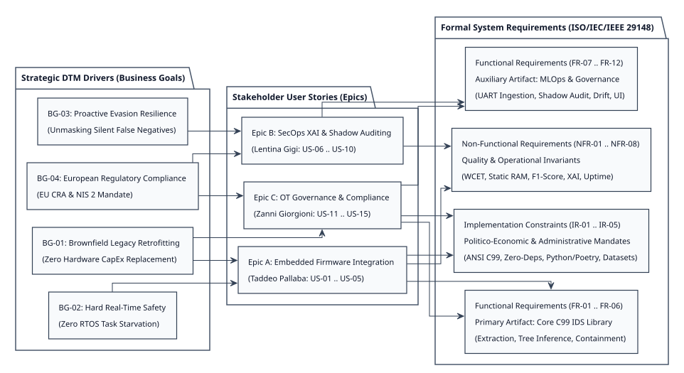
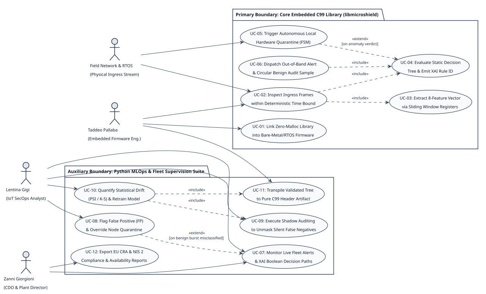
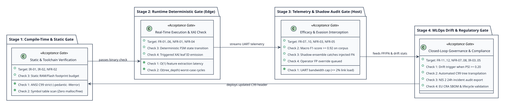

# Chapter 2: Requirements Engineering & Digital Transformation Alignment

---

## 2.1 Methodological Framework & Strategic DTM Context

In accordance with **ISO/IEC/IEEE 29148:2018** (*Systems and software engineering — Life cycle processes — Requirements engineering*) [1], this chapter establishes the formal specification of **what** the MicroShield ecosystem must accomplish, strictly decoupled from **how** its internal data structures and algorithms are implemented (which emerges in the subsequent architectural and detailed design phases).

Within the discipline of **Digital Transformation Management (DTM)**, industrial organizations face a structural paradox when modernizing Operational Technology (OT) and telecommunications infrastructures:
1. **Brownfield Legacy Constraints:** Critical manufacturing plants, energy substations, and fieldbus networks rely on thousands of already-deployed, deeply constrained microcontrollers (MCUs) with decades-long operational lifecycles. Replacing this hardware to support heavyweight cybersecurity agents is financially unsustainable.
2. **Real-Time Safety Invariants:** Any security software introduced into an embedded control loop must respect hard real-time execution boundaries; a single unbounded latency spike or heap exhaustion fault can halt physical production lines.
3. **Regulatory Enforcement:** European mandates—specifically the **EU Cyber Resilience Act (CRA)** [2] and the **NIS 2 Directive** [3]—legally compel operators to enforce continuous anomaly detection, vulnerability lifecycle management, and rapid incident reporting across all connected assets.

To resolve this triad, MicroShield structures its requirements engineering process as a top-down traceability hierarchy. High-level **Strategic Business Goals (`BG`)** motivate role-specific **Stakeholder User Stories (`US`)**, which in turn derive verifiable **Functional Requirements (`FR`)**, quantitative **Non-Functional Requirements (`NFR`)**, and strictly justified **Implementation Constraints (`IR`)**.

*(Click on the diagram to open the full-resolution vector graphic in a new tab)*  
*Figure 2.1: Hierarchical Requirements Breakdown Structure (RBS) mapping Digital Transformation Business Goals (`BG-01..04`) to Stakeholder Epics (`US-01..15`) and ISO/IEC/IEEE 29148 Requirement Categories.*

---

## 2.2 Domain & Technical Glossary

To eliminate semantic ambiguity across embedded firmware engineering, telecommunications traffic analysis, and executive cybersecurity governance, Table 2.1 defines the core domain terminology referenced throughout this specification.

| Term / Acronym | Domain Category | Formal Definition within MicroShield |
| :--- | :--- | :--- |
| **Bare-Metal / RTOS** | Embedded Systems | Execution environments running directly on microcontroller hardware without an operating system (bare-metal) or managed by a deterministic Real-Time Operating System (e.g., FreeRTOS, Zephyr) lacking virtual memory protection (MMU). |
| **Brownfield Retrofitting** | Digital Transformation | The practice of upgrading legacy, in-service industrial hardware with modern digital capabilities (such as inline cybersecurity) via firmware updates, avoiding capital expenditure (CapEx) on hardware replacement. |
| **Concept Drift** | Machine Learning / Telecom | A statistical change over time in the joint probability distribution `P(X, Y)` of network telemetry features `X` and traffic classes `Y`, induced by evolving attack toolkits or seasonal shifts in legitimate industrial workloads. |
| **False Negative (FN)** | Detection Epistemology | An evasion failure wherein a malicious network frame is erroneously classified as `BENIGN_TRAFFIC` by the edge detector, producing no local alert and requiring out-of-band *Shadow Auditing* to unmask. |
| **False Positive (FP)** | Detection Epistemology | A classification error wherein legitimate operational traffic is flagged as an anomaly, potentially triggering unnecessary containment and requiring operator override feedback. |
| **Inter-Arrival Time (IAT)** | Telecommunications | The elapsed time delta (`iat_delta`, measured in microseconds) between two consecutive frames arriving at a physical network or serial interface, crucial for identifying volumetric floods and scanning probes. |
| **Out-of-Band UART** | Telecommunications | A dedicated, physically isolated serial communication channel (`Universal Asynchronous Receiver-Transmitter`) used to stream security alerts and audit samples without contending with primary fieldbus bandwidth. |
| **Population Stability Index (PSI)** | Statistical Governance | A symmetric information-theoretic metric quantifying how much the probability distribution of incoming live telemetry features has shifted relative to the baseline training dataset (**Bot-IoT** / **Edge-IIoTset**). |
| **Shadow Auditing** | SecOps Architecture | An asymmetric verification mechanism in which the edge MCU periodically samples frames classified as benign and forwards them to a high-capacity host ensemble model to detect silent False Negatives. |
| **Shannon Payload Entropy** | Information Theory | A normalized measure (`[0.0, 1.0]` or scaled integer equivalent) of byte-level randomness within a packet payload, used to distinguish structured industrial telemetry from encrypted shells or binary exploit payloads. |
| **Transpilation** | MLOps / Compilers | The automated source-to-source translation of a trained mathematical model (e.g., a Scikit-Learn Decision Tree) into self-contained, dependency-free ANSI C99 source and header files. |
| **WCET** | Real-Time Systems | *Worst-Case Execution Time*: the strict, mathematically provable upper bound on the CPU clock cycles or microseconds required to execute a software routine under any valid input vector. |
| **XAI (White-Box Rule)** | Explainable AI | *Explainable Artificial Intelligence*: a classification paradigm in which every verdict is accompanied by a human-auditable boolean trace of physical feature threshold comparisons rather than opaque neural weights. |
| **Zero-Malloc Invariant** | Memory Safety | A strict software constraint prohibiting dynamic heap memory allocation (`malloc`, `calloc`, `realloc`, `free`) at runtime, ensuring deterministic memory usage and complete immunity to heap fragmentation. |

*Table 2.1: Normative glossary of domain-specific terms, mathematical metrics, and regulatory acronyms.*

---

## 2.3 Stakeholder User Stories & Use Case Modeling

Following the agile requirements methodology formalized by Mike Cohn [4], functional and qualitative expectations are captured through structured **User Stories** (`As a <Role>, I want <Goal>, so that <Business/Technical Value>`). 

While the **Core Embedded C99 Library (`libmicroshield`)** represents the primary engineering artifact, the User Stories encompass its complete operational symbiosis with the **Auxiliary MLOps & Fleet Supervision Suite**. Figure 2.2 illustrates the unified UML Use Case topology across both system boundaries.

*(Click on the diagram to open the full-resolution vector graphic in a new tab)*  
*Figure 2.2: UML Use Case diagram depicting human personas, physical fieldbus actors, and `<<include>>`/`<<extend>>` relationships across the Primary C99 Edge Boundary and Auxiliary MLOps Governance Boundary.*

---

### 2.3.1 Epic Cohort A: Embedded Firmware & Real-Time Telecommunications (Taddeo Pallabà)

Taddeo Pallabà (*Senior Embedded Firmware & RTOS Engineer*) represents the technical gatekeeper of the physical field domain. His user stories prioritize deterministic execution, memory safety, and zero-friction firmware integration.

* **`US-01` (Zero-Malloc Static Integration):**  
  *As an* Embedded Firmware Engineer, *I want* to integrate the intrusion detection engine as a self-contained static library that allocates zero dynamic heap memory at runtime, *so that* I can deploy inline security on bare-metal and FreeRTOS microcontrollers without risking heap fragmentation or `HardFault` crashes.
* **`US-02` (Deterministic Wire-Speed Frame Inspection):**  
  *As an* Embedded Firmware Engineer, *I want* every incoming network or fieldbus frame to be evaluated within a strictly bounded, predictable number of CPU cycles (`O(tree_depth)`), *so that* high-frequency packet bursts never starve safety-critical motor-control interrupts or trigger hardware watchdog resets.
* **`US-03` (Constant-Time Sliding-Window Feature Extraction):**  
  *As an* Embedded Firmware Engineer, *I want* the library to compute volumetric, temporal (IAT), and Shannon entropy metrics incrementally in constant time (`O(1)`) without buffering raw multi-packet payloads, *so that* SRAM consumption remains fixed below a few hundred bytes regardless of traffic volume.
* **`US-04` (Autonomous Hardware-Level Fault Containment):**  
  *As an* Embedded Firmware Engineer, *I want* the edge library to drive a deterministic mitigation Finite-State Machine (FSM) capable of signaling immediate local quarantine (e.g., frame drop or GPIO isolation pin assertion) upon detecting sustained floods, *so that* a compromised link is contained in microseconds without waiting for round-trip server instructions.
* **`US-05` (Automated Header Transpilation & Toolchain Verification):**  
  *As an* Embedded Firmware Engineer, *I want* updated machine-learning models to be delivered as drop-in, compiler-verified C99 header files validated against strict flags (`-Wall -Wextra -Werror -pedantic`), *so that* I never have to manually translate data-science parameters into embedded firmware code.

---

### 2.3.2 Epic Cohort B: SecOps Telemetry, Explainable AI & Evasion Discovery (Lentina Gigi)

Lentina Gigi (*Industrial IoT SecOps Analyst*) governs day-to-day threat monitoring and model maintenance. Her user stories address explainability, alert fatigue, silent evasion discovery, and statistical drift adaptation.

* **`US-06` (White-Box Explainable AI Decision Traceability):**  
  *As an* IoT SecOps Analyst, *I want* every anomaly alert arriving from an edge node to include the exact sequence of boolean feature thresholds traversed in the decision tree (e.g., `iat_delta <= 115us AND payload_entropy > 0.80`), *so that* I can immediately verify the physical cause of an incident rather than guessing at opaque neural probability scores.
* **`US-07` (Interactive False Positive Override & Quarantine Release):**  
  *As an* IoT SecOps Analyst, *I want* to flag misclassified legitimate traffic bursts as False Positives (`FP`) directly from the supervision console and remotely clear precautionary node quarantines, *so that* benign industrial workload spikes do not cause prolonged operational disruptions.
* **`US-08` (Asymmetric Shadow Auditing for False Negative Discovery):**  
  *As an* IoT SecOps Analyst, *I want* the edge library to periodically sample a lightweight fraction of traffic classified as `BENIGN_TRAFFIC`—especially frames passing near decision boundary thresholds—and forward them to a high-capacity host ensemble verifier, *so that* silent False Negatives (`FN`) and zero-day evasion attempts are automatically unmasked.
* **`US-09` (Quantitative Concept Drift Monitoring):**  
  *As an* IoT SecOps Analyst, *I want* the supervision suite to continuously compute statistical divergence metrics (Population Stability Index and Kolmogorov-Smirnov statistics) between live field telemetry and baseline training distributions, *so that* I receive early warnings when evolving network behavior degrades edge model accuracy.
* **`US-10` (Closed-Loop Retraining on Verified Discrepancies):**  
  *As an* IoT SecOps Analyst, *I want* to trigger automated model retraining that folds operator-verified False Positives and Shadow-Audited False Negatives into the reference **Bot-IoT** and **Edge-IIoTset** corpora, *so that* the fleet rapidly adapts to new threat patterns while preserving depth and accuracy invariants.

---

### 2.3.3 Epic Cohort C: Digital Transformation Governance, CapEx & Compliance (Zanni Giorgioni)

Zanni Giorgioni (*Chief Digital Officer & Plant Operations Director*) oversees strategic transformation, financial sustainability, and regulatory compliance. His user stories connect technical capabilities to business risk reduction.

* **`US-11` (Zero-CapEx Brownfield Fleet Retrofitting):**  
  *As a* Chief Digital Officer, *I want* the core intrusion detection capability to run entirely within the spare Flash and SRAM margins of our existing deployed microcontrollers, *so that* we achieve plant-wide cyber resilience through firmware updates without spending millions of euros on gateway hardware replacements.
* **`US-12` (Lateral Movement Prevention & Plant Availability):**  
  *As a* Plant Operations Director, *I want* compromised or flooded field sensors to be autonomously isolated at the physical edge before malicious traffic propagates across the shared plant backbone, *so that* localized attacks cannot cause factory-wide unscheduled downtime.
* **`US-13` (NIS 2 24-Hour Incident Dossier Generation):**  
  *As a* Chief Digital Officer, *I want* the supervision platform to maintain tamper-evident, structured forensic logs of all edge incidents, XAI rules, and containment actions, *so that* our organization can generate statutory incident notifications within the strict 24-hour early-warning window mandated by Article 23 of the **NIS 2 Directive**.
* **`US-14` (EU Cyber Resilience Act Lifecycle Compliance):**  
  *As a* Chief Digital Officer, *I want* documented evidence of security-by-design DoS protection, zero third-party runtime dependencies (minimal SBOM), and closed-loop vulnerability updateability, *so that* our industrial products legally qualify for CE marking under the **EU Cyber Resilience Act (CRA)**.
* **`US-15` (Executive Fleet Risk & Stability Visibility):**  
  *As a* Plant Operations Director, *I want* a high-level governance view displaying fleet-wide node health, quarantine ratios, False Positive/Negative rates, and model drift status, *so that* I can quantify cybersecurity Return on Investment (ROI) and operational stability during board and regulatory audits.

| User Story ID | Persona | Strategic DTM Driver | MoSCoW Priority | Derived System Requirements |
| :--- | :--- | :--- | :--- | :--- |
| **`US-01`** | Taddeo Pallabà | `BG-01`, `BG-02` | **Must Have** | `FR-01`, `NFR-02`, `IR-01`, `IR-02` |
| **`US-02`** | Taddeo Pallabà | `BG-02` | **Must Have** | `FR-03`, `NFR-01` |
| **`US-03`** | Taddeo Pallabà | `BG-01`, `BG-02` | **Must Have** | `FR-01`, `FR-02`, `NFR-01`, `NFR-02` |
| **`US-04`** | Taddeo Pallabà | `BG-02`, `BG-04` | **Must Have** | `FR-05`, `NFR-06` |
| **`US-05`** | Taddeo Pallabà | `BG-01`, `BG-04` | **Must Have** | `FR-11`, `NFR-07`, `IR-01`, `IR-05` |
| **`US-06`** | Lentina Gigi | `BG-03`, `BG-04` | **Must Have** | `FR-04`, `FR-06`, `FR-12`, `NFR-04` |
| **`US-07`** | Lentina Gigi | `BG-02`, `BG-03` | **Should Have** | `FR-08`, `FR-12`, `NFR-06` |
| **`US-08`** | Lentina Gigi | `BG-03` | **Must Have** | `FR-06`, `FR-07`, `FR-09`, `NFR-03`, `NFR-05` |
| **`US-09`** | Lentina Gigi | `BG-03`, `BG-04` | **Should Have** | `FR-10`, `NFR-03` |
| **`US-10`** | Lentina Gigi | `BG-03`, `BG-04` | **Must Have** | `FR-10`, `FR-11`, `IR-03`, `IR-04` |
| **`US-11`** | Zanni Giorgioni | `BG-01` | **Must Have** | `FR-01`, `NFR-02`, `IR-01` |
| **`US-12`** | Zanni Giorgioni | `BG-02` | **Must Have** | `FR-05`, `NFR-01`, `NFR-06` |
| **`US-13`** | Zanni Giorgioni | `BG-04` | **Should Have** | `FR-07`, `FR-12`, `NFR-04`, `NFR-08` |
| **`US-14`** | Zanni Giorgioni | `BG-04` | **Must Have** | `FR-03`, `FR-11`, `NFR-08`, `IR-02`, `IR-05` |
| **`US-15`** | Zanni Giorgioni | `BG-01`, `BG-04` | **Could Have** | `FR-10`, `FR-12`, `NFR-08` |

*Table 2.2: Traceability mapping of Stakeholder User Stories (`US-01..15`) to Strategic DTM Goals, MoSCoW prioritization, and formal System Requirements.*

---

## 2.4 Functional Requirements Specification (`FR`)

The Functional Requirements specify the observable input-to-output transformations and behavioral capabilities required of the software. To preserve the architectural hierarchy established in Chapter 1, the requirements are partitioned between the **Primary Artifact (Core Embedded C99 IDS Library)** and the **Auxiliary Artifact (Python MLOps & Fleet Supervision Suite)**.

### 2.4.1 Primary Artifact: Core Embedded C99 Detection Library (`FR-01` .. `FR-06`)

* **`FR-01` (Stateless & Sliding-Window Frame Ingestion):**  
  The embedded library shall expose an interface to ingest raw communication frames (comprising byte payload pointer, frame byte length, arrival timestamp in microseconds, and physical interface identifier) and update internal sliding-window telemetry state without retaining copies of past frame payloads.
  * *Acceptance Criteria (`AC-FR-01`):* **Given** an initialized library instance and a stream of 10,000 consecutive frames of varying lengths (1 to 1,500 bytes), **When** each frame is passed to the ingestion API, **Then** the library shall update its temporal and volumetric counters accurately while consuming zero additional bytes of memory proportional to stream length.

* **`FR-02` (Eight-Dimensional Feature Vector Extraction):**  
  For every ingested frame, the embedded library shall extract a normalized 8-feature telemetry vector capturing: (1) payload byte length, (2) protocol category identifier, (3) transport control flags bitmask, (4) inter-arrival time delta (`iat_delta`), (5) sliding-window packet rate, (6) sliding-window IAT jitter variance, (7) source connection fan-in cardinality, and (8) normalized Shannon byte entropy of the payload.
  * *Acceptance Criteria (`AC-FR-02`):* **Given** synthetic reference frames with known analytical properties (e.g., a uniform all-zero payload with `entropy = 0` vs. a pseudo-random encrypted payload with `entropy -> max`, and fixed `iat_delta = 100us`), **When** feature extraction is executed, **Then** all 8 extracted metrics shall match theoretical ground-truth values within a deterministic quantization tolerance of `<= 1 LSB` (Least Significant Bit).

* **`FR-03` (Multi-Class Threat Classification):**  
  The embedded library shall evaluate each extracted 8-feature vector against a compiled Decision Tree logic model and return a deterministic multi-class verdict categorizing the frame into one of at least four canonical classes: `BENIGN_TRAFFIC`, `ANOMALY_DOS_FLOOD`, `ANOMALY_SCAN_PROBE`, or `ANOMALY_INJECTION`.
  * *Acceptance Criteria (`AC-FR-03`):* **Given** a validation set of pre-labeled feature vectors covering all four traffic classes, **When** evaluated by the C library runtime, **Then** the output verdicts shall achieve `100%` bit-for-bit identity with the predictions of the reference offline Decision Tree model from which the C logic was transpiled.

* **`FR-04` (White-Box Explainability Trace Emission):**  
  Alongside the classification verdict, the embedded library shall output the unique identifier of the terminal decision leaf (`rule_id`) and the boolean threshold path responsible for the classification.
  * *Acceptance Criteria (`AC-FR-04`):* **Given** any evaluated frame yielding an anomaly verdict, **When** the evaluation result structure is inspected, **Then** it shall contain a valid, non-null `rule_id` mapping bijectively to a documented boolean conjunction of physical feature thresholds.

* **`FR-05` (Autonomous Local Mitigation State Machine):**  
  The embedded library shall maintain a deterministic per-interface Finite-State Machine (FSM) that transitions across operational states (`NORMAL`, `ELEVATED_ALERT`, `INTERFACE_QUARANTINED`) based on configurable anomaly burst counters and cooldown timers, returning an explicit containment directive (`ALLOW_FRAME`, `DROP_FRAME`, `ISOLATE_LINK`) to the host firmware.
  * *Acceptance Criteria (`AC-FR-05`):* **Given** an interface in `NORMAL` state configured with a quarantine threshold of `N = 5` consecutive DoS frames, **When** `5` consecutive `ANOMALY_DOS_FLOOD` verdicts occur, **Then** the FSM shall deterministically transition to `INTERFACE_QUARANTINED`, emit `ISOLATE_LINK`, and return to `NORMAL` only after a configured clean cooldown window or explicit operator reset.

* **`FR-06` (Asymmetric Telemetry & Stratified Benign Sampling):**  
  The embedded library shall format compact out-of-band diagnostic telemetry records for all detected anomalies (`100%` of alerts) and for a configurable stratified circular sample of frames classified as `BENIGN_TRAFFIC` (specifically prioritizing boundary-adjacent benign frames whose feature values fall within a configurable margin of a split threshold).
  * *Acceptance Criteria (`AC-FR-06`):* **Given** a mixed stream of 1,000 benign frames and 10 attack frames with sampling ratio `1:100`, **When** processed by the library, **Then** exactly `10` anomaly alert records and `10` benign audit sample records (plus any boundary-adjacent frames within margin) shall be queued for serial transmission.

---

### 2.4.2 Auxiliary Artifact: MLOps Governance, Shadow Auditing & Supervision Suite (`FR-07` .. `FR-12`)

* **`FR-07` (Out-of-Band Telemetry & Audit Stream Ingestion):**  
  The host supervision service shall ingest framed telemetry records over physical or virtualized serial (UART) streams, validate frame integrity via checksum/CRC verification, and route anomaly alerts and benign shadow samples to their respective analytical pipelines.
  * *Acceptance Criteria (`AC-FR-07`):* **Given** a stream of 5,000 valid telemetry frames interspersed with 50 corrupted byte sequences (flipped bits), **When** ingested by the collector daemon, **Then** `100%` of valid frames shall be parsed and persisted into structured storage while `100%` of corrupted frames shall be rejected and logged as link framing errors without crashing the service.

* **`FR-08` (Interactive False Positive Flagging & Quarantine Override):**  
  The supervision suite shall allow an authorized SecOps analyst to label any reported anomaly incident as a False Positive (`FP`), append the misclassified feature vector to the retraining feedback buffer, and issue an out-of-band command to reset the edge node's mitigation FSM back to `NORMAL`.
  * *Acceptance Criteria (`AC-FR-08`):* **Given** a quarantined edge node and an active alert in the console, **When** the analyst invokes the FP override action, **Then** the incident record shall be marked `VERIFIED_FP`, the vector shall be stored in the feedback dataset with ground-truth label `BENIGN_TRAFFIC`, and the edge FSM shall resume `NORMAL` state.

* **`FR-09` (Shadow Auditing for Silent False Negative Interception):**  
  The supervision suite shall evaluate incoming benign audit samples (`FR-06`) against a high-capacity server-side reference ensemble (e.g., Random Forest / Isolation Forest) and automatically generate a high-priority **False Negative Discrepancy Alert** whenever the ensemble classifies an edge-approved benign sample as malicious.
  * *Acceptance Criteria (`AC-FR-09`):* **Given** a batch of evasive attack vectors intentionally crafted to bypass a shallow depth-4 edge tree while remaining detectable by a depth-20 Random Forest ensemble, **When** these vectors arrive via the benign shadow sample stream, **Then** the `ShadowAuditAnalyzer` shall flag `>= 90%` of them as unmasked False Negatives (`VERIFIED_FN`) and queue them for retraining.

* **`FR-10` (Statistical Concept Drift Quantification):**  
  The MLOps pipeline shall compute sliding-window statistical divergence metrics—specifically the **Population Stability Index (PSI)** and two-sample **Kolmogorov-Smirnov (K-S) test**—across all 8 telemetry features relative to the active model's training baseline, triggering a drift state when divergence exceeds calibrated thresholds.
  * *Acceptance Criteria (`AC-FR-10`):* **Given** a baseline telemetry distribution and a synthetically shifted stream where mean `iat_delta` or `payload_size` shifts by `>= 2` standard deviations, **When** evaluated by the drift monitor, **Then** the computed PSI shall exceed the critical threshold (`PSI >= 0.20`) and automatically assert the `DRIFT_DETECTED` flag.

* **`FR-11` (Closed-Loop Model Retraining & C99 Code Transpilation):**  
  Upon drift detection or manual invocation, the MLOps toolkit shall merge verified `FP`/`FN` feedback vectors with curated benchmark partitions (**Bot-IoT** and **Edge-IIoTset**), train a depth-constrained Decision Tree, validate its classification metrics, and automatically transpile the resulting tree into a self-contained, syntax-checked ANSI C99 header/source artifact.
  * *Acceptance Criteria (`AC-FR-11`):* **Given** a retraining trigger with new feedback data, **When** the transpilation pipeline completes, **Then** it shall output a `.h`/`.c` artifact that compiles with zero warnings under `gcc -std=c99 -Wall -Wextra -Werror -pedantic` and satisfies all depth and memory invariants.

* **`FR-12` (Visual SecOps Console & Regulatory Compliance Export):**  
  The supervision suite shall provide a web-based dashboard displaying live incident heatmaps, XAI boolean decision paths, Shadow Audit FN discrepancies, and drift metrics, alongside a one-click export of structured forensic reports compliant with **NIS 2** and **EU CRA** audit schemas.
  * *Acceptance Criteria (`AC-FR-12`):* **Given** logged security incidents and drift events, **When** the operator views the dashboard or requests a compliance export, **Then** the system shall render the XAI rules in human-readable syntax and generate a complete, timestamped JSON/Markdown audit dossier within `< 2 seconds`.

---

## 2.5 Non-Functional Requirements Specification (`NFR`)

Non-Functional Requirements define the strict quality attributes, operational invariants, and quantitative boundaries that constrain system behavior across embedded and host tiers.

| Req. ID | Quality Dimension | Formal Non-Functional Specification | Quantitative Acceptance Criteria (`AC-NFR`) |
| :--- | :--- | :--- | :--- |
| **`NFR-01`** | **Real-Time Determinism & WCET** | Feature extraction (`FR-02`) and Decision Tree evaluation (`FR-03`) on the embedded target shall execute in strictly bounded time (`O(1)` and `O(tree_depth)` respectively), devoid of unbounded loops, recursion, or data-dependent dynamic waits. | Maximum tree depth constrained to `D <= 8`. Worst-Case Execution Time (WCET) per frame shall not exceed **`<= 50 microseconds`** (or **`<= 4,000 CPU clock cycles`** on an 80 MHz ARM Cortex-M4 reference core) across `1,000,000` stress-test frames. |
| **`NFR-02`** | **Memory Footprint & Heap Safety** | The core embedded library (`libmicroshield`) shall enforce a strict **Zero-Malloc Invariant**, utilizing exclusively compile-time static storage (`.text`, `.rodata`, `.bss`, `.data`) and bounded stack frames. | Static RAM (`.bss` + `.data`) footprint **`<= 2.0 KB`**; Flash (`.text` + `.rodata`) footprint **`<= 16.0 KB`**; Stack usage **`<= 512 Bytes`**. Binary symbol inspection (`nm` / `objdump`) shall verify `0` references to `malloc`, `calloc`, `realloc`, or `free`. |
| **`NFR-03`** | **Classification Efficacy & Robustness** | The transpiled Decision Tree model shall maintain high multi-class detection accuracy across volumetric, probing, and injection attacks while minimizing operational False Positives. | On held-out test partitions of **Bot-IoT** and **Edge-IIoTset**, the transpiled C99 engine shall achieve a **Macro F1-Score `>= 0.92`**, **Recall `>= 0.94`** on DoS/DDoS classes, and a **False Positive Rate (FPR) `<= 1.5%`**. |
| **`NFR-04`** | **Explainability & Audit Traceability** | Every security verdict generated by the system shall be 100% deterministic, reproducible, and accompanied by a complete white-box boolean explanation of the physical feature splits traversed. | `100%` of emitted anomaly alerts shall resolve to an explicit boolean rule string with `<= D` clauses; feeding an identical 8-feature vector into the engine at any point in time shall yield the exact same verdict and `rule_id` with zero stochastic variance. |
| **`NFR-05`** | **Telemetry Channel Overhead** | Out-of-band serial telemetry and stratified benign shadow sampling (`FR-06`) shall not saturate the diagnostic UART link or degrade primary embedded application throughput. | Under normal traffic conditions, shadow audit sampling shall consume **`<= 2.0%`** of a standard `115,200 bps` UART link capacity (`<= 230 Bytes/sec`), with each compact binary telemetry frame sized at **`<= 32 Bytes`**. |
| **`NFR-06`** | **Reliability & Fault Containment** | The embedded library and host ingestion daemon shall exhibit fail-safe resilience against malformed network frames, truncated serial bytes, division-by-zero conditions, and integer overflows. | Fuzz testing the C99 ingestion API with `10,000,000` random/mutated byte buffers (`0` to `65,535` bytes) under AddressSanitizer (`ASan`) and UndefinedBehaviorSanitizer (`UBSan`) shall produce **`0` crashes, `0` memory leaks, and `0` undefined behaviors**. |
| **`NFR-07`** | **Portability & Hardware Agnosticism** | The core embedded library shall be completely decoupled from specific microcontroller vendor HALs (Hardware Abstraction Layers) or OS kernels, interacting solely through standard C99 data types. | The exact same C99 source code (`libmicroshield`) shall compile and pass `100%` of unit tests natively on `x86_64-linux-gnu` (GCC/Clang) and cross-compiled for `arm-none-eabi-gcc` (ARM Cortex-M4/M7) without conditional `#ifdef` platform hacks. |
| **`NFR-08`** | **Regulatory & Lifecycle Compliance** | The ecosystem shall satisfy the technical monitoring, DoS resilience, SBOM minimization, and incident reporting timelines required by European cybersecurity legislation. | Full alignment matrix verified against **EU CRA Annex I** and **NIS 2 Article 21/23**, with automated generation of structured forensic incident dossiers well within the statutory **`< 24-hour`** reporting mandate. |

*Table 2.3: Non-Functional Requirements (`NFR-01..08`) specification and quantitative verification thresholds.*

---

## 2.6 Implementation Requirements & Politico-Economic Justifications (`IR`)

In strict adherence to software engineering principles, implementation choices should ordinarily emerge during architectural design rather than being imposed a priori as requirements. However, in real-world industrial Digital Transformation projects, specific technological boundaries are externally dictated by **economic survival, corporate governance policies, legal liabilities, and institutional mandates**. 

Table 2.4 formalizes the five Implementation Constraints (`IR-01` .. `IR-05`) governing MicroShield, explicitly documenting the **politico-economic, administrative, and regulatory justifications** that mandate each constraint prior to design.

| Constraint ID | Implementation Mandate | Politico-Economic, Administrative & Legal Justification | Acceptance Criteria (`AC-IR`) |
| :--- | :--- | :--- | :--- |
| **`IR-01`** | **Strict ANSI C99 Standard (`-std=c99`) for the Core Embedded Library** | **Economic (CapEx Preservation) & Corporate Safety Governance:** Industrial plants operate heterogeneous brownfield fleets (ARM Cortex-M, Texas Instruments C2000, Microchip PIC32, legacy RISC-V) whose vendor-certified toolchains often lack C++14/17/20 or Rust support. Mandating pure ANSI C99 protects millions of euros in deployed hardware CapEx (`BG-01`) and aligns with corporate **MISRA-C** administrative safety policies for critical OT firmware. | All files within the core library module compile cleanly under `gcc -std=c99 -Wall -Wextra -Werror -pedantic` with zero GNU extensions (`-Wpedantic`). |
| **`IR-02`** | **Zero Third-Party Runtime Dependencies on the Edge Target** | **Legal & Supply-Chain Liability (EU CRA Mandate):** Under **EU Cyber Resilience Act (Regulation 2024/2847)** Annex I, manufacturers are legally liable for vulnerabilities in third-party libraries included in the Software Bill of Materials (SBOM). Prohibiting external C dependencies (`libc` math/heap extensions or external crypto/ML libs) reduces third-party supply-chain risk to zero and simplifies legal CE compliance audits. | Shared/static library dependency analysis (`ldd` / `arm-none-eabi-objdump`) confirms zero external library links beyond standard compiler-provided freestanding headers (`<stdint.h>`, `<stddef.h>`, `<stdbool.h>`). |
| **`IR-03`** | **Python 3 (`>= 3.10`) Managed via Poetry for the Auxiliary MLOps & Governance Tier** | **Organizational Interoperability & Academic Governance:** Enterprise SecOps and Data Science teams standardize on Python (Scikit-Learn, NumPy, Pandas, PySerial) for analytics. Administratively, the university software engineering governance mandates **Poetry** (`pyproject.toml` + deterministic `poetry.lock`) to guarantee reproducible virtual environments across grading and CI/CD runners. | Auxiliary suite installs and executes deterministically via `poetry install --no-root` and `poetry run pytest` inside a clean container environment. |
| **`IR-04`** | **Empirical Grounding on Public Benchmark Corpora (Bot-IoT & Edge-IIoTset)** | **Legal Privacy (GDPR / NDA) & Scientific Auditability:** Corporate non-disclosure agreements (NDAs) and NIS 2 security policies strictly prohibit publishing live proprietary factory network captures in open repositories. Mandating peer-reviewed academic datasets (**Bot-IoT** [5] and **Edge-IIoTset** [6]) satisfies legal confidentiality while enabling external auditors to deterministically reproduce training metrics. | Automated MLOps data loaders ingest and validate standardized feature schemas derived from **Bot-IoT** and **Edge-IIoTset** distributions during CI/CD verification. |
| **`IR-05`** | **GitFlow Branching Discipline, Conventional Commits & Containerized CI/CD** | **Administrative Quality Assurance & Audit Traceability:** Both academic evaluation criteria and **IEC 62443-4-1** secure development lifecycle (SDL) standards require full traceability from requirements to release artifacts via isolated feature branches (`feature/*`), integration staging (`develop`), and immutable tagged releases on `master` verified by automated pipelines. | Repository history (`git log --graph`) demonstrates strict adherence to GitFlow merges, Conventional Commits syntax, and passing GitHub Actions workflows. |

*Table 2.4: Implementation Constraints (`IR-01..05`), politico-economic/administrative justifications, and verification criteria.*

---

## 2.7 Verification Lifecycle & Bidirectional Traceability Matrix

To guarantee that every requirement and acceptance criterion specified in this chapter is systematically validated during the implementation and testing phases (Chapters 6, 7, and 8), MicroShield enforces a four-stage **Verification & Acceptance Lifecycle**, illustrated in Figure 2.3.

*(Click on the diagram to open the full-resolution vector graphic in a new tab)*  
*Figure 2.3: Four-stage verification and acceptance pipeline connecting compile-time static checks, deterministic edge WCET gates, Shadow Auditing FN discovery, and closed-loop MLOps compliance.*

Table 2.5 provides the complete **Bidirectional Requirements Traceability Matrix (RTM)**, cross-referencing each requirement ID to its originating User Stories, Acceptance Gate, Verification Method, and primary academic course alignment (**SE**: *Software Engineering — Prof. Ciatto*; **TLC**: *Software per le Telecomunicazioni — Prof. Guidotti*).

| Req. ID | Requirement Title | Originating User Stories | Verification Stage & Method | Course Alignment |
| :--- | :--- | :--- | :--- | :--- |
| **`FR-01`** | Stateless & Sliding-Window Frame Ingestion | `US-01`, `US-03`, `US-11` | **Stage 2:** C99 Unit Test & Memory Profiler | **TLC** (Primary) / **SE** |
| **`FR-02`** | Eight-Dimensional Feature Vector Extraction | `US-03` | **Stage 2:** Analytical Ground-Truth Unit Test | **TLC** (Primary) |
| **`FR-03`** | Multi-Class Threat Classification | `US-02`, `US-14` | **Stage 2:** Cross-Tier Bit-Identity Test | **TLC** & **SE** |
| **`FR-04`** | White-Box Explainability Trace Emission | `US-06` | **Stage 2:** XAI Rule-ID Bijective Assertion | **SE** & **TLC** |
| **`FR-05`** | Autonomous Local Mitigation State Machine | `US-04`, `US-12` | **Stage 2:** Deterministic FSM Transition Test | **TLC** (Primary) / **SE** |
| **`FR-06`** | Asymmetric Telemetry & Benign Sampling | `US-06`, `US-08` | **Stage 2 & 3:** Stratified Sampling Ratio Test | **TLC** & **SE** |
| **`FR-07`** | Out-of-Band Telemetry & Stream Ingestion | `US-08`, `US-13` | **Stage 3:** UART CRC Framing & Fuzz Test | **TLC** (Primary) / **SE** |
| **`FR-08`** | Interactive FP Flagging & Quarantine Override | `US-07` | **Stage 3:** Integration Test (Console -> FSM) | **SE** (Primary) |
| **`FR-09`** | Shadow Auditing for Silent FN Interception | `US-08` | **Stage 3:** Adversarial Evasion Injection Test | **SE** & **TLC** |
| **`FR-10`** | Statistical Concept Drift Quantification | `US-09`, `US-10`, `US-15` | **Stage 4:** Synthetic Distribution Shift (PSI/K-S) | **SE** & **TLC** |
| **`FR-11`** | Closed-Loop Retraining & C99 Transpilation | `US-05`, `US-10`, `US-14` | **Stage 4 & 1:** End-to-End Transpiler & GCC Build | **SE** (Primary) |
| **`FR-12`** | Visual SecOps Console & Compliance Export | `US-06`, `US-07`, `US-13`, `US-15` | **Stage 4:** UI Rendering & NIS 2 Schema Check | **SE** (Primary) |
| **`NFR-01`** | Real-Time Determinism & WCET Bound | `US-02`, `US-03`, `US-12` | **Stage 2:** Cycle-Accurate Timing Benchmark | **TLC** (Primary) |
| **`NFR-02`** | Memory Footprint & Zero-Malloc Safety | `US-01`, `US-03`, `US-11` | **Stage 1:** ELF Symbol & Size Gate (`size`/`nm`) | **TLC** & **SE** |
| **`NFR-03`** | Classification Efficacy & Macro F1-Score | `US-08`, `US-09` | **Stage 3:** Benchmark Evaluation (Bot-IoT/Edge-IIoT) | **TLC** & **SE** |
| **`NFR-04`** | Explainability & Audit Traceability | `US-06`, `US-13` | **Stage 2 & 4:** Determinism & XAI Path Audit | **SE** (Primary) |
| **`NFR-05`** | Telemetry Channel Bandwidth Overhead | `US-08` | **Stage 3:** Serial Baud-Rate Utilization Benchmark | **TLC** (Primary) |
| **`NFR-06`** | Reliability, Fuzz Safety & Fault Containment | `US-04`, `US-07`, `US-12` | **Stage 2:** `ASan`/`UBSan` 10M-Frame Fuzz Gate | **SE** & **TLC** |
| **`NFR-07`** | Portability & Hardware Agnosticism | `US-05` | **Stage 1:** Multi-Target CI Matrix (`x86_64` + `ARM`) | **SE** (Primary) |
| **`NFR-08`** | Regulatory & Lifecycle Compliance (CRA/NIS 2) | `US-13`, `US-14`, `US-15` | **Stage 4:** Regulatory Dossier & SBOM Audit | **SE** (Primary) |
| **`IR-01`** | Strict ANSI C99 Standard (`-std=c99`) | `US-01`, `US-05`, `US-11` | **Stage 1:** Compiler Strictness Gate (`-pedantic`) | **SE** & **TLC** |
| **`IR-02`** | Zero Third-Party Edge Runtime Dependencies | `US-01`, `US-14` | **Stage 1:** Binary Linkage Inspection (`objdump`) | **SE** & **TLC** |
| **`IR-03`** | Python 3 + Poetry Auxiliary MLOps Suite | `US-10` | **Stage 4:** Reproducible Lockfile CI Build | **SE** (Primary) |
| **`IR-04`** | Public Benchmark Grounding (Bot-IoT/Edge-IIoT) | `US-10` | **Stage 3:** Dataset Schema & Integrity Check | **TLC** & **SE** |
| **`IR-05`** | GitFlow Discipline & Containerized CI/CD | `US-05`, `US-14` | **Stage 1..4:** Automated GitHub Actions Pipeline | **SE** (Primary) |

*Table 2.5: Bidirectional Requirements Traceability Matrix (RTM) linking Requirements, User Stories, Acceptance Gates, and Dual-Course Academic Objectives.*

---

## 2.8 References & Methodological Standards

1. **ISO/IEC/IEEE** (2018). *ISO/IEC/IEEE 29148:2018 — Systems and software engineering — Life cycle processes — Requirements engineering*. International Organization for Standardization, Geneva.
2. **European Parliament and Council of the European Union** (2024). *Regulation (EU) 2024/2847 on horizontal cybersecurity requirements for products with digital elements (Cyber Resilience Act)*. Official Journal of the European Union.
3. **European Parliament and Council of the European Union** (2022). *Directive (EU) 2022/2555 on measures for a high common level of cybersecurity across the Union (NIS 2 Directive)*. Official Journal of the European Union, L 333/80.
4. **Cohn, M.** (2004). *User Stories Applied: For Agile Software Development*. Addison-Wesley Professional.
5. **Koroniotis, N., Moustafa, N., Sitnikova, E., & Turnbull, B.** (2019). *Towards the development of realistic botnet dataset in the Internet of Things for network forensic analytics: Bot-IoT dataset*. Future Generation Computer Systems, 100, 779–796.
6. **Ferrag, M. A., Friha, O., Hamouda, D., Maglaras, L., & Janicke, H.** (2022). *Edge-IIoTset: A New Comprehensive Realistic Cyber Security Dataset of IoT and IIoT Applications for Centralized and Federated Learning*. IEEE Access, 10, 40281–40306.
7. **MISRA Consortium** (2012). *MISRA C:2012 Guidelines for the Use of the C Language in Critical Systems*. HORIBA MIRA Limited.
