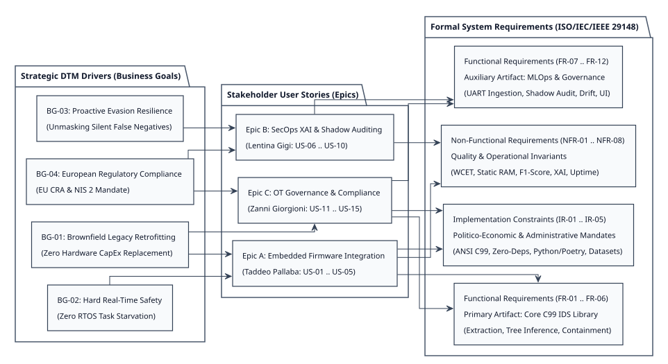
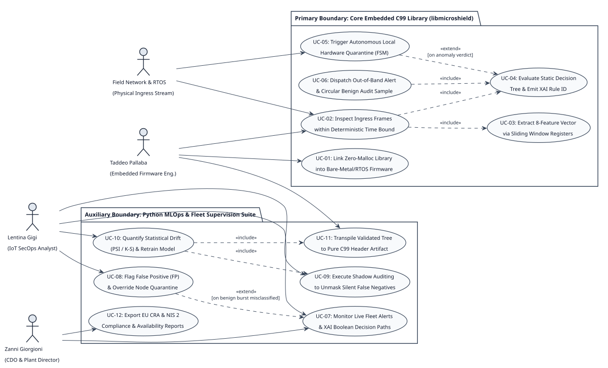
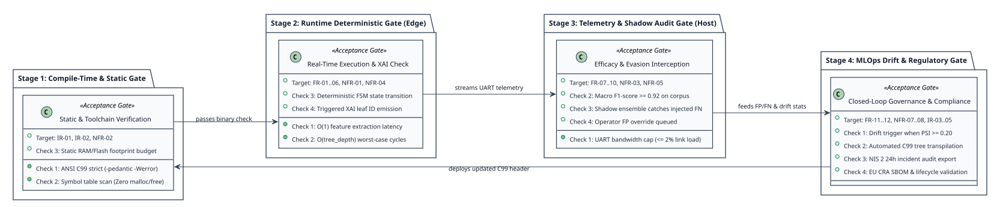

# Chapter 2: Requirements Engineering & Digital Transformation Alignment

---

## 2.1 Methodological Framework & Strategic DTM Context

In accordance with **ISO/IEC/IEEE 29148:2018** (*Systems and software engineering — Life cycle processes — Requirements engineering*) [1], this chapter establishes the formal specification of **what** the MicroShield ecosystem must accomplish, strictly decoupled from **how** its internal data structures and algorithms are implemented.

Within the discipline of **Digital Transformation Management (DTM)**, industrial organizations face a structural paradox when modernizing Operational Technology (OT), healthcare supply chains, and telecommunications infrastructures:
1. **The Brownfield Vulnerability Gap:** Critical manufacturing plants, medical blood-plasma storage banks, and transport networks rely on thousands of already-deployed, deeply constrained microcontrollers (MCUs) with decades-long operational lifecycles. As exposed by the **early November 2026 European cyber-physical crisis** (the Danfoss/Dixell `CVE-2025-41450/41451` refrigeration hijackings and BBT SE tunnel intrusions), replacing legacy controllers with modern gateways is economically prohibitive (CapEx), while manual firmware patching is rarely enacted by field operators.
2. **Real-Time Safety & Operational Invariants:** Any security monitor introduced into an embedded control loop must respect hard real-time execution boundaries. Furthermore, as demonstrated by the November 2026 civil aviation bomb-hoax storm, security systems must not fall victim to *induced false-positive alert storms* that force catastrophic self-lockdowns.
3. **Binding Regulatory & Agency Mandates:** European directives—specifically the **EU Cyber Resilience Act (CRA)** [2], the **NIS 2 Directive** [3], and the urgent operational alerts issued by the **Italian National Cybersecurity Agency (ACN / CSIRT Italia)** on November 3–5, 2026 [8]—legally compel operators to enforce continuous anomaly detection, supply-chain cyber hygiene, and rapid 24-hour incident containment across essential digital assets.

To resolve this triad, MicroShield structures its requirements engineering process as a top-down traceability hierarchy. High-level **Strategic Business Goals (`BG`)** motivate role-specific **Stakeholder User Stories (`US`)**, which in turn derive verifiable **Functional Requirements (`FR`)**, quantitative **Non-Functional Requirements (`NFR`)**, and strictly justified **Implementation Constraints (`IR`)**.

  
*(Click on the diagram to open the full-resolution vector graphic)*  
*Figure 2.1: Hierarchical Requirements Breakdown Structure (RBS) mapping Digital Transformation Business Goals (`BG-01..04`) to Stakeholder Epics (`US-01..15`) and ISO/IEC/IEEE 29148 Requirement Categories.*

---

## 2.2 Domain & Technical Glossary

To eliminate semantic ambiguity across embedded firmware engineering, telecommunications traffic analysis, and executive cybersecurity governance, Table 2.1 defines the core domain terminology referenced throughout this specification.

| Term / Acronym | Domain Category | Formal Definition within MicroShield |
| :--- | :--- | :--- |
| **Bare-Metal / RTOS** | Embedded Systems | Execution environments running directly on microcontroller hardware without an operating system (bare-metal) or managed by a deterministic Real-Time Operating System (e.g., FreeRTOS, Zephyr) lacking virtual memory paging (MMU). |
| **Brownfield Retrofitting** | Digital Transformation | The practice of upgrading legacy, in-service industrial hardware with modern digital capabilities (such as inline intrusion detection) via lightweight firmware updates, avoiding hardware replacement CapEx. |
| **Concept Drift** | Machine Learning / Telecom | A statistical change over time in the joint probability distribution `P(X, Y)` of network telemetry features `X` and traffic classes `Y`, induced by evolving attack toolkits or seasonal shifts in industrial workloads. |
| **Continuous Threat-Driven CI/CD Gate** | Software Engineering | An automated quality gate within the CI/CD pipeline that ingests machine-readable national vulnerability advisories (e.g., ACN / CISA descriptors) and validates detection recall and WCET bounds on every commit. |
| **False Negative (FN)** | Detection Epistemology | An evasion failure wherein a malicious frame (e.g., stealthy Danfoss setpoint manipulation) is erroneously classified as `BENIGN_TRAFFIC` by the edge detector, requiring out-of-band *Shadow Auditing* to unmask. |
| **False Positive (FP)** | Detection Epistemology | A classification error wherein legitimate operational traffic is flagged as an anomaly, potentially triggering unnecessary containment and requiring operator override feedback. |
| **Induced Alert Storm** | Cyber-Physical Security | An adversarial strategy that injects borderline or spoofed threat signatures to provoke security monitors into precautionary shutdowns (the European aviation hoax paradigm), requiring leaky-bucket damping. |
| **Inter-Arrival Time (IAT)** | Telecommunications | The elapsed time delta (`iat_delta_us`, in microseconds) between two consecutive frames arriving at a physical network interface, crucial for identifying volumetric floods and scanning sweeps. |
| **Out-of-Band UART** | Telecommunications | A dedicated, physically isolated serial communication channel (`Universal Asynchronous Receiver-Transmitter`) used to stream security telemetry without contending with primary fieldbus bandwidth. |
| **Population Stability Index (PSI)** | Statistical Governance | A symmetric information-theoretic metric quantifying how much the probability distribution of incoming live telemetry features has shifted relative to baseline training distributions (**Bot-IoT** / **Edge-IIoTset**). |
| **Semantic Setpoint Tampering** | ICS / SCADA Security | An attack modifying physical control parameters (e.g., forcing cryo-freezers from `-30 °C` to `+110 °C` via `CVE-2025-41451`) while maintaining syntactically valid communication framing. |
| **Shadow Auditing** | SecOps Architecture | An asymmetric verification mechanism in which the edge MCU periodically samples frames classified as benign and forwards them to a high-capacity host ensemble model to detect silent False Negatives. |
| **Shannon Payload Entropy** | Information Theory | A normalized measure (`[0.0, 1.0]` or integer `Q8` equivalent) of byte-level randomness within a packet payload, used to distinguish structured telemetry from encrypted shells or binary exploit code. |
| **Transpilation** | MLOps / Compilers | The automated source-to-source translation of a trained mathematical model (e.g., a Scikit-Learn Decision Tree) into self-contained, dependency-free ANSI C99 source and header files (`ms_tree_node_t[]`). |
| **WCET** | Real-Time Systems | *Worst-Case Execution Time*: the strict, mathematically provable upper bound on CPU clock cycles or microseconds required to execute a software routine under any valid input vector. |
| **XAI (Glass-Box Rule)** | Explainable AI | *Ante-Hoc Explainable Artificial Intelligence*: a classification paradigm where every verdict is accompanied by a human-auditable boolean trace of physical feature threshold comparisons (Rudin, 2019). |
| **Zero-Malloc Invariant** | Memory Safety | A strict software constraint prohibiting dynamic heap memory allocation (`malloc`, `calloc`, `realloc`, `free`) at runtime, ensuring deterministic memory usage and complete immunity to heap fragmentation. |

*Table 2.1: Normative glossary of domain-specific terms, mathematical metrics, and regulatory acronyms.*

---

## 2.3 Stakeholder User Stories & Use Case Modeling

Following agile requirements engineering principles, functional and qualitative expectations are captured through structured **User Stories** (`As a <Role>, I want <Goal>, so that <Business/Technical Value>`). 

While the **Core Embedded C99 Library (`libmicroshield`)** represents the primary engineering artifact, the User Stories encompass its complete operational symbiosis with **`Dashield`** (the **Auxiliary MLOps & Fleet Supervision Suite**) and the threat scenarios highlighted by the November 2026 European crisis. Figure 2.2 illustrates the unified UML Use Case topology across both system boundaries.

  
*(Click on the diagram to open the full-resolution vector graphic)*  
*Figure 2.2: UML Use Case diagram depicting human personas, physical fieldbus actors, and `<<include>>`/`<<extend>>` relationships across the Primary C99 Edge Boundary and Auxiliary MLOps Governance Boundary.*

---

### 2.3.1 Epic Cohort A: Embedded Firmware & Real-Time Telecommunications (Taddeo Pallabà)

Taddeo Pallabà (*Senior Embedded Firmware & RTOS Engineer*) represents the technical gatekeeper of the physical field domain. His user stories prioritize deterministic execution, memory safety, and resilience against both floods and induced alert storms.

* **`US-01` (Zero-Malloc Static Integration):**  
  *As an* Embedded Firmware Engineer, *I want* to integrate the intrusion detection engine as a self-contained static library allocating zero dynamic heap memory at runtime, *so that* I can deploy inline security on bare-metal and FreeRTOS microcontrollers without risking heap fragmentation or `HardFault` crashes.
* **`US-02` (Deterministic Wire-Speed Frame Inspection):**  
  *As an* Embedded Firmware Engineer, *I want* every incoming network frame to be evaluated within a strictly bounded number of CPU cycles (`O(tree_depth)`), *so that* high-frequency packet bursts never starve safety-critical compressor control loops or trigger watchdog resets.
* **`US-03` (Constant-Time Sliding-Window Feature Extraction):**  
  *As an* Embedded Firmware Engineer, *I want* the library to compute volumetric, temporal (IAT), and Shannon entropy metrics incrementally in constant time (`O(1)`) using fixed-point `Q8` integer math, *so that* SRAM consumption remains fixed below 128 bytes regardless of traffic volume.
* **`US-04` (Autonomous 5-Stage Containment & Alert-Storm Resistance):**  
  *As an* Embedded Firmware Engineer, *I want* the edge library to drive a 5-state mitigation FSM (combining a Leaky Bucket filter with exponential backoff), *so that* sporadic anomalous frames (the aviation hoax scenario) are dropped without closing the link, while sustained floods or lateral scans (the Brenner Tunnel scenario) trigger autonomous hardware lockdown (`LOCKDOWN_L3`).
* **`US-05` (Automated Threat-Driven Header Transpilation & CI/CD Verification):**  
  *As an* Embedded Firmware Engineer, *I want* updated machine-learning models to be delivered as drop-in, compiler-verified C99 header files (`ms_tree_node_t[]`) validated against strict flags (`-Wall -Wextra -Werror -pedantic`) and ACN threat regression suites, *so that* I never have to manually port data-science models into firmware.

---

### 2.3.2 Epic Cohort B: SecOps Telemetry, Glass-Box AI & Evasion Discovery (Lentina Gigi)

Lentina Gigi (*Industrial IoT SecOps Analyst*) governs operational threat monitoring and model maintenance. Her user stories address alert fatigue, explainability, silent evasion discovery, and statistical drift adaptation.

* **`US-06` (Ante-Hoc Glass-Box Decision Traceability):**  
  *As an* IoT SecOps Analyst, *I want* every anomaly alert arriving from an edge node to include the exact sequence of boolean feature thresholds traversed in the decision tree (e.g., `iat_delta <= 120us AND payload_entropy_q8 > 210 -> ANOMALY_INJECTION`), *so that* I can immediately verify the physical cause of an incident without relying on opaque post-hoc neural approximations.
* **`US-07` (Interactive False Positive Override & Quarantine Release):**  
  *As an* IoT SecOps Analyst, *I want* to flag misclassified legitimate burst traffic as False Positives (`FP`) directly from the supervision console and remotely reset node quarantines via an authenticated command, *so that* benign industrial workload spikes do not cause prolonged operational downtime.
* **`US-08` (Asymmetric Shadow Auditing for Stealthy Setpoint Evasion):**  
  *As an* IoT SecOps Analyst, *I want* the edge library to periodically sample benign frames (prioritizing boundary-adjacent frames) and forward them to a high-capacity host ensemble verifier, *so that* silent False Negatives—such as stealthy cold-chain setpoint tampering commands (`CVE-2025-41451`) that slip past the shallow edge tree—are automatically unmasked.
* **`US-09` (Quantitative Concept Drift Monitoring & Readiness Index):**  
  *As an* IoT SecOps Analyst, *I want* the supervision suite to continuously compute statistical divergence metrics (PSI and Kolmogorov-Smirnov statistics) and aggregate them into a visual Retraining Readiness Gauge, *so that* I receive early warnings when evolving network behavior degrades edge model accuracy.
* **`US-10` (Closed-Loop Retraining on Verified Discrepancies):**  
  *As an* IoT SecOps Analyst, *I want* to trigger automated model retraining that integrates operator-verified False Positives and Shadow-Audited False Negatives into the reference **Bot-IoT** and **Edge-IIoTset** corpora, *so that* the fleet rapidly adapts to new threat patterns while preserving depth and accuracy invariants.

---

### 2.3.3 Epic Cohort C: Digital Transformation Governance, CapEx & Compliance (Zanni Giorgioni)

Zanni Giorgioni (*Chief Digital Officer & Plant Operations Director*) oversees strategic transformation, financial sustainability, and regulatory compliance. His user stories connect technical capabilities to business risk reduction.

* **`US-11` (Zero-CapEx Brownfield Fleet Retrofitting):**  
  *As a* Chief Digital Officer, *I want* the core intrusion detection capability to run entirely within the spare Flash and SRAM margins of our existing deployed microcontrollers (e.g., STM32F407RE), *so that* we resolve the brownfield vulnerability gap exposed by the November 2026 crisis through firmware updates without hardware replacement CapEx.
* **`US-12` (Lateral Movement Prevention & Plant Continuity):**  
  *As a* Plant Operations Director, *I want* compromised or scanned field sensors to be autonomously isolated at the physical edge before malicious traffic propagates laterally across the plant backbone (the BBT SE containment model), *so that* localized breaches cannot cause plant-wide outages.
* **`US-13` (NIS 2 & ACN 24-Hour Forensic Dossier Generation):**  
  *As a* Chief Digital Officer, *I want* the supervision platform to maintain structured forensic logs of all edge incidents, glass-box rules, and containment actions, *so that* our organization can generate statutory incident notifications within the strict 24-hour early-warning window mandated by Article 23 of the **NIS 2 Directive** and **ACN guidelines**.
* **`US-14` (EU Cyber Resilience Act Lifecycle Compliance):**  
  *As a* Chief Digital Officer, *I want* documented evidence of security-by-design DoS protection, zero third-party runtime dependencies (minimal SBOM), and closed-loop vulnerability updateability, *so that* our industrial products legally qualify for CE marking under the **EU Cyber Resilience Act (CRA)**.
* **`US-15` (Executive Digital-Twin Risk & Incident Visibility):**  
  *As a* Plant Operations Director, *I want* a high-level governance dashboard displaying fleet-wide node health, quarantine ratios, False Positive/Negative rates, and live scenario simulation results, *so that* I can quantify cybersecurity Return on Investment (ROI) and operational resilience during regulatory audits.

| User Story ID | Persona | Strategic DTM Driver | MoSCoW Priority | Derived System Requirements |
| :--- | :--- | :--- | :--- | :--- |
| **`US-01`** | Taddeo Pallabà | `BG-01`, `BG-02` | **Must Have** | `FR-01`, `NFR-02`, `IR-01`, `IR-02` |
| **`US-02`** | Taddeo Pallabà | `BG-02` | **Must Have** | `FR-03`, `NFR-01` |
| **`US-03`** | Taddeo Pallabà | `BG-01`, `BG-02` | **Must Have** | `FR-01`, `FR-02`, `NFR-01`, `NFR-02` |
| **`US-04`** | Taddeo Pallabà | `BG-02`, `BG-04` | **Must Have** | `FR-05`, `NFR-06` |
| **`US-05`** | Taddeo Pallabà | `BG-01`, `BG-04` | **Must Have** | `FR-11`, `NFR-07`, `IR-01`, `IR-05` |
| **`US-06`** | Lentina Gigi | `BG-03`, `BG-04` | **Must Have** | `FR-04`, `FR-06`, `FR-12`, `NFR-04` |
| **`US-07`** | Lentina Gigi | `BG-02`, `BG-03` | **Should Have** | `FR-08`, `FR-12`, `NFR-06` |
| **`US-08`** | Lentina Gigi | `BG-03` | **Must Have** | `FR-06`, `FR-07`, `FR-09`, `NFR-03`, `NFR-05` |
| **`US-09`** | Lentina Gigi | `BG-03`, `BG-04` | **Should Have** | `FR-10`, `NFR-03` |
| **`US-10`** | Lentina Gigi | `BG-03`, `BG-04` | **Must Have** | `FR-10`, `FR-11`, `IR-03`, `IR-04` |
| **`US-11`** | Zanni Giorgioni | `BG-01` | **Must Have** | `FR-01`, `NFR-02`, `IR-01` |
| **`US-12`** | Zanni Giorgioni | `BG-02` | **Must Have** | `FR-05`, `NFR-01`, `NFR-06` |
| **`US-13`** | Zanni Giorgioni | `BG-04` | **Should Have** | `FR-07`, `FR-12`, `NFR-04`, `NFR-08` |
| **`US-14`** | Zanni Giorgioni | `BG-04` | **Must Have** | `FR-03`, `FR-11`, `NFR-08`, `IR-02`, `IR-05` |
| **`US-15`** | Zanni Giorgioni | `BG-01`, `BG-04` | **Could Have** | `FR-10`, `FR-12`, `NFR-08` |

*Table 2.2: Traceability mapping of Stakeholder User Stories (`US-01..15`) to Strategic DTM Goals, MoSCoW prioritization, and formal System Requirements.*

---

## 2.4 Functional Requirements Specification (`FR`)

The Functional Requirements specify the observable input-to-output transformations and behavioral capabilities required of the software, partitioned between the **Primary Artifact (`libmicroshield` C99)** and the **Auxiliary Artifact (`Dashield` Python Suite)**.

### 2.4.1 Primary Artifact: Core Embedded C99 Detection Library (`FR-01` .. `FR-06`)

* **`FR-01` (Stateless & Sliding-Window Frame Ingestion):**  
  The embedded library shall expose an interface to ingest raw communication frames (payload pointer, byte length, arrival timestamp, interface identifier) and update internal sliding-window state without buffering past frame payloads.
  * *Acceptance Criteria (`AC-FR-01`):* **Given** an initialized library instance and a stream of 10,000 frames of varying lengths (1 to 1,500 bytes), **When** each frame is passed to the ingestion API, **Then** internal counters shall update accurately while consuming zero additional bytes of dynamic memory proportional to stream length.

* **`FR-02` (Eight-Dimensional Naturally Aligned Feature Extraction):**  
  For every ingested frame, the embedded library shall extract a normalized 8-feature telemetry vector packed into a naturally aligned 12-byte layout: (1) `iat_delta_us` (32-bit), (2) `payload_len` (16-bit), (3) `proto_id` (8-bit), (4) `transport_flags` (8-bit), (5) `pkt_rate_win` (8-bit), (6) `jitter_win` (8-bit), (7) `conn_fan_in_win` (8-bit), and (8) `payload_entropy_q8` (8-bit, computed via Flash LUT).
  * *Acceptance Criteria (`AC-FR-02`):* **Given** reference frames with known analytical properties (e.g., all-zero payload vs. high-entropy exploit code), **When** feature extraction is executed, **Then** all 8 metrics shall match theoretical ground-truth within `<= 1 LSB` tolerance without incurring memory padding bytes.

* **`FR-03` (Multi-Class Threat Classification):**  
  The embedded library shall evaluate each 8-feature vector against a compiled static Decision Tree node array (`ms_tree_node_t[]`) and return a deterministic multi-class verdict: `BENIGN_TRAFFIC`, `ANOMALY_DOS_FLOOD`, `ANOMALY_SCAN_PROBE`, or `ANOMALY_INJECTION`.
  * *Acceptance Criteria (`AC-FR-03`):* **Given** a validation set of pre-labeled feature vectors covering all four classes, **When** evaluated by the C99 runtime, **Then** output verdicts shall achieve 100% bit-for-bit identity with the predictions of the offline CART model from which the C logic was transpiled.

* **`FR-04` (Ante-Hoc Glass-Box Decision Path Emission):**  
  Alongside the classification verdict, the embedded library shall output the unique leaf identifier (`matched_rule_id`) mapping directly to the boolean sequence of physical threshold splits traversed in the tree.
  * *Acceptance Criteria (`AC-FR-04`):* **Given** any evaluated frame yielding an anomaly verdict, **When** the inspection result is examined, **Then** it shall contain a valid `matched_rule_id` resolving to an explicit conjunction of physical feature thresholds without requiring post-hoc approximation algorithms.

* **`FR-05` (5-Stage Escalation Mitigation State Machine):**  
  The embedded library shall maintain a per-interface Finite-State Machine (FSM) implementing a Leaky Bucket filter combined with Binary Exponential Backoff across five operational states (`NORMAL`, `SUSPICIOUS`, `THROTTLED_L1`, `QUARANTINED_L2`, `LOCKDOWN_L3`), returning explicit actions (`ALLOW`, `DROP`, `MICRO_BLOCK`, `EXP_BLOCK`, `HW_LOCKDOWN`).
  * *Acceptance Criteria (`AC-FR-05`):* **Given** an interface under test, **When** subjected to sporadic anomalous frames (the aviation hoax scenario), **Then** the FSM shall drop individual frames (`SUSPICIOUS`) without shutting down the link; **When** subjected to a sustained attack burst (the BBT SE or flood scenario), **Then** the FSM shall escalate progressively to `LOCKDOWN_L3`, disabling the receive interrupt until reset.

* **`FR-06` (Asymmetric Telemetry & Stratified Benign Sampling):**  
  The embedded library shall format compact 24-byte binary telemetry records (`CRC-16-CCITT`) for all detected anomalies (`100%`) and for a configurable stratified sample of benign frames (prioritizing boundary-adjacent frames whose feature values pass within margin $\epsilon$ of split thresholds).
  * *Acceptance Criteria (`AC-FR-06`):* **Given** a stream of 1,000 benign frames and 10 attack frames with sampling ratio `1:100`, **When** processed by the library, **Then** exactly 10 anomaly records and 10 benign audit sample records (plus boundary-adjacent frames) shall be serialized for UART transmission.

---

### 2.4.2 Auxiliary Artifact: MLOps Governance, Shadow Auditing & Supervision Suite (`FR-07` .. `FR-12`)

* **`FR-07` (Out-of-Band Telemetry & Binary Ingestion):**  
  The host supervision service shall ingest framed 24-byte telemetry records over physical UART or virtualized TCP sockets, validate frame integrity via CRC-16 checksums, and route anomaly alerts and benign shadow samples to their respective domain handlers.
  * *Acceptance Criteria (`AC-FR-07`):* **Given** 5,000 valid telemetry frames interspersed with 50 corrupted byte sequences (flipped bits), **When** ingested by the collector daemon, **Then** 100% of valid frames shall be persisted into structured SQLite storage while corrupted frames shall be rejected and logged as framing errors without service crash.

* **`FR-08` (Interactive False Positive Flagging & Quarantine Reset):**  
  The supervision suite shall allow an authorized SecOps analyst to label any reported anomaly as a False Positive (`FP`), append the vector to the retraining store with label `BENIGN`, and issue an authenticated command frame (`CMD_RESET_FSM`) to restore a locked-down edge node back to `NORMAL`.
  * *Acceptance Criteria (`AC-FR-08`):* **Given** a locked-down edge node and an active alert in the console, **When** the analyst invokes the FP override action, **Then** the record shall be marked `VERIFIED_FP`, the vector stored in the feedback dataset, and the edge FSM restored to `NORMAL`.

* **`FR-09` (Shadow Auditing for Silent False Negative Interception):**  
  The supervision suite shall evaluate incoming benign audit samples (`FR-06`) against a 100-tree Random Forest reference ensemble and automatically generate an **Unmasked False Negative Alert (`UNMASKED_FN`)** whenever the ensemble detects an attack signature (e.g., stealthy Danfoss setpoint tampering) within an edge-approved benign frame.
  * *Acceptance Criteria (`AC-FR-09`):* **Given** a batch of evasive command-tampering vectors designed to bypass shallow edge trees, **When** these vectors arrive via the benign shadow stream, **Then** the `ShadowAuditAnalyzer` shall flag $\ge 90\%$ of them as unmasked False Negatives and queue them for retraining.

* **`FR-10` (Statistical Concept Drift & Retraining Readiness Gauge):**  
  The MLOps pipeline shall compute sliding-window Population Stability Index (PSI) and Kolmogorov-Smirnov statistics across all 8 features, combining supervised error rates (FPs + FNs) and unsupervised covariate shift into a composite Retraining Readiness Index (`0%..100%`).
  * *Acceptance Criteria (`AC-FR-10`):* **Given** an operational stream where input distributions shift or accumulated errors breach calibrated thresholds, **When** evaluated by the drift monitor, **Then** the composite index shall transition to `RED (>= 80%)` and trigger the retraining alert.

* **`FR-11` (Threat-Driven Retraining & C99 Node Array Transpilation):**  
  Upon drift trigger, operator invocation, or ingestion of a new ACN/CSIRT advisory descriptor, the MLOps toolkit shall merge verified feedback into the training corpus, train a depth-constrained Decision Tree, validate classification metrics, and automatically transpile the tree into a syntax-checked ANSI C99 node array (`ms_tree_node_t[]`).
  * *Acceptance Criteria (`AC-FR-11`):* **Given** a retraining trigger with new feedback data, **When** the transpilation pipeline completes, **Then** it shall output an `ms_tree_model.h` artifact compiling with zero warnings under `gcc -std=c99 -Wall -Wextra -Werror -pedantic` and satisfying depth bounds ($D \le 8$).

* **`FR-12` (Digital-Twin Scenario Simulator & Compliance Export):**  
  The supervision suite shall provide an interactive pure-Python console displaying live telemetry, Glass-Box rule paths, and a **Critical Infrastructure Scenario Simulator** reproducing November 2026 threat profiles (Cold-Chain Setpoint Hijack, Tunnel Reconnaissance, Alert Storms), alongside one-click export of **NIS 2** (< 24h) and **EU CRA** forensic audit dossiers.
  * *Acceptance Criteria (`AC-FR-12`):* **Given** recorded security incidents and simulated scenarios, **When** the operator requests a compliance export, **Then** the system shall generate a structured JSON/Markdown audit dossier within $< 2$ seconds.

---

## 2.5 Non-Functional Requirements Specification (`NFR`)

Non-Functional Requirements define the strict quality attributes, operational invariants, and quantitative boundaries constraining system behavior.

| Req. ID | Quality Dimension | Formal Non-Functional Specification | Quantitative Acceptance Criteria (`AC-NFR`) |
| :--- | :--- | :--- | :--- |
| **`NFR-01`** | **Real-Time Determinism & WCET** | Feature extraction (`FR-02`) and tree evaluation (`FR-03`) shall execute in strictly bounded time (`O(1)` and `O(tree_depth)`), devoid of unbounded loops, recursion, or dynamic waits. | Tree depth constrained to $D \le 8$. Worst-Case Execution Time (WCET) per frame shall not exceed **`<= 1,500 CPU clock cycles`** (`<= 8.9 us` on STM32F407RE @ 168 MHz) with execution jitter **`< 20 cycles`**, verified via hardware `DWT->CYCCNT`. |
| **`NFR-02`** | **Memory Footprint & Heap Safety** | The embedded library (`libmicroshield`) shall enforce a strict **Zero-Malloc Invariant**, utilizing exclusively compile-time static storage and bounded stack frames. | Dynamic Heap: **`0 Bytes`** (`0` calls to `malloc`/`free`). Static RAM (`.bss` + `.data`): **`<= 128 Bytes`** per interface context. Stack usage: **`<= 96 Bytes`**. Total Flash: **`<= 4.0 KB`**. |
| **`NFR-03`** | **Classification Efficacy & Robustness** | The transpiled Decision Tree shall maintain high multi-class accuracy across volumetric, probing, and injection attacks while minimizing False Positives. | On test partitions of **Bot-IoT**, **Edge-IIoTset**, and Nov 2026 threat profiles, the C99 engine shall achieve a **Macro F1-Score `>= 0.92`**, **Recall `>= 0.94`** on DoS/Injection, and an **FPR `<= 1.5%`**. |
| **`NFR-04`** | **Glass-Box Interpretability & Traceability** | Every classification verdict shall be 100% reproducible and accompanied by an ante-hoc boolean trace of the physical threshold splits traversed. | 100% of emitted alerts shall resolve to an explicit boolean rule string with $\le D$ clauses; identical input vectors shall yield identical verdicts with zero stochastic variance. |
| **`NFR-05`** | **Telemetry Channel Bandwidth Overhead** | Out-of-band serial telemetry and stratified benign shadow sampling (`FR-06`) shall not saturate diagnostic serial links. | Under nominal conditions, shadow sampling shall consume **`<= 2.0%`** of a standard `115,200 bps` UART link capacity (`<= 230 Bytes/sec`), with each binary frame fixed at **`24 Bytes`**. |
| **`NFR-06`** | **Reliability, Fuzz Safety & Alert Damping** | The C99 library and host ingestion daemon shall exhibit fail-safe resilience against malformed network frames, serial noise, and spoofed alert storms. | Fuzz testing the C99 API with 10,000,000 mutated buffers under `ASan`/`UBSan` shall produce **`0` crashes and `0` undefined behaviors**. The 5-stage FSM shall absorb sporadic anomalies without link closure. |
| **`NFR-07`** | **Portability & Hardware Agnosticism** | The core embedded library shall be decoupled from vendor HALs and RTOS kernels, interacting solely through standard C99 fixed-width integer types (`stdint.h`). | The exact same C99 source code shall compile cleanly under `gcc -std=c99 -Wall -Wextra -Werror -pedantic` for `x86_64` (Docker) and `arm-none-eabi-gcc` (**STM32F407RE**) without `#ifdef` platform hacks. |
| **`NFR-08`** | **Regulatory & Lifecycle Compliance** | The ecosystem shall satisfy the monitoring, DoS resilience, minimal SBOM, and incident reporting timelines of European cybersecurity legislation. | Full compliance matrix verified against **EU CRA Annex I** and **NIS 2 Article 21/23**, with automated generation of structured incident dossiers within the statutory **`< 24-hour`** mandate. |

*Table 2.3: Non-Functional Requirements (`NFR-01..08`) specification and quantitative verification thresholds.*

---

## 2.6 Implementation Requirements & Politico-Economic Justifications (`IR`)

Table 2.4 formalizes the five Implementation Constraints (`IR-01` .. `IR-05`) governing MicroShield, documenting the **politico-economic, administrative, and regulatory justifications** that mandate each constraint.

| Constraint ID | Implementation Mandate | Politico-Economic, Administrative & Regulatory Justification | Acceptance Criteria (`AC-IR`) |
| :--- | :--- | :--- | :--- |
| **`IR-01`** | **Strict ANSI C99 Standard (`-std=c99`) for Core Library** | **CapEx Preservation & MISRA-C Governance:** Industrial and healthcare plants operate legacy brownfield microcontrollers (ARM Cortex-M, RISC-V) whose certified toolchains lack modern C++ or Rust runtimes. Mandating pure ANSI C99 protects deployed hardware investments (`BG-01`) and satisfies corporate MISRA-C safety policies. | Core library compiles under `gcc -std=c99 -Wall -Wextra -Werror -pedantic` with zero GNU-specific extensions (`-Wpedantic`). |
| **`IR-02`** | **Zero Third-Party Runtime Dependencies on Edge** | **Supply-Chain Liability (EU CRA Mandate):** Under EU Cyber Resilience Act Annex I, manufacturers bear strict legal liability for vulnerabilities in third-party libraries within the Software Bill of Materials (SBOM). Prohibiting external C libraries reduces third-party supply-chain exposure to zero. | Binary linkage inspection (`objdump`) confirms zero dynamic links beyond compiler-provided freestanding headers (`<stdint.h>`, `<stdbool.h>`). |
| **`IR-03`** | **Unified Python 3 (`>= 3.10`) Managed via Poetry for Host** | **Single-Language MLOps Stack & Reproducibility:** Enterprise data science and SecOps teams standardize on Python (Scikit-Learn, SciPy, PySerial). Managing dependencies through Poetry (`pyproject.toml` + `poetry.lock`) guarantees deterministic build reproducibility across CI/CD runners and operator workstations. | Host suite installs and executes deterministically via `poetry install --no-root` and `poetry run pytest` within clean containerized environments. |
| **`IR-04`** | **Empirical Grounding on Public Corpora & ACN Descriptors** | **Legal Privacy (GDPR/NDA) & Scientific Auditability:** Non-disclosure agreements and critical infrastructure secrecy laws prohibit publishing proprietary SCADA captures. Grounding models on academic corpora (**Bot-IoT**, **Edge-IIoTset**) and published ACN advisory descriptors enables deterministic reproduction. | Automated loaders validate dataset schemas and ACN regression descriptors during automated verification. |
| **`IR-05`** | **GitFlow Discipline, Conventional Commits & Threat-Driven CI/CD** | **Secure Software Development Lifecycle (IEC 62443-4-1):** Industrial security standards mandate complete traceability from requirements to deployment via isolated feature branches, staged integration on `develop`, immutable tagged releases on `master`, and automated threat regression testing. | Repository history demonstrates strict GitFlow merges, Conventional Commits syntax, and passing GitHub Actions workflows. |

*Table 2.4: Implementation Constraints (`IR-01..05`), justifications, and verification criteria.*

---

## 2.7 Verification Lifecycle & Bidirectional Traceability Matrix

Figure 2.3 illustrates the four-stage **Verification & Acceptance Lifecycle** through which every requirement is systematically validated.

  
*(Click on the diagram to open the full-resolution vector graphic)*  
*Figure 2.3: Four-stage verification and acceptance pipeline connecting compile-time static checks, deterministic edge WCET gates, Shadow Auditing FN discovery, and closed-loop MLOps compliance.*

Table 2.5 provides the complete **Bidirectional Requirements Traceability Matrix (RTM)**, cross-referencing each requirement ID to originating User Stories, Verification Stages, and academic course alignment.

| Req. ID | Requirement Title | Originating User Stories | Verification Stage & Method | Course Alignment |
| :--- | :--- | :--- | :--- | :--- |
| **`FR-01`** | Stateless & Sliding-Window Frame Ingestion | `US-01`, `US-03`, `US-11` | **Stage 2:** C99 Unit Test & Memory Profiler | **TLC** (Primary) / **SE** |
| **`FR-02`** | Eight-Dimensional Naturally Aligned Feature Vector | `US-03` | **Stage 2:** Analytical Ground-Truth Test | **TLC** (Primary) |
| **`FR-03`** | Multi-Class Threat Classification | `US-02`, `US-14` | **Stage 2:** Cross-Tier Bit-Identity Assertion | **TLC** & **SE** |
| **`FR-04`** | Ante-Hoc Glass-Box Decision Path Emission | `US-06` | **Stage 2:** Rule-ID Bijective Mapping Test | **SE** & **TLC** |
| **`FR-05`** | 5-Stage Escalation Mitigation State Machine | `US-04`, `US-12` | **Stage 2:** Deterministic FSM Transition Benchmark | **TLC** (Primary) / **SE** |
| **`FR-06`** | Asymmetric Telemetry & Stratified Benign Sampling | `US-06`, `US-08` | **Stage 2 & 3:** Sampling Ratio & Boundary Assertion | **TLC** & **SE** |
| **`FR-07`** | Out-of-Band Telemetry & Binary Ingestion | `US-08`, `US-13` | **Stage 3:** UART CRC-16 Framing & Fuzz Test | **TLC** (Primary) / **SE** |
| **`FR-08`** | Interactive FP Flagging & Quarantine Reset | `US-07` | **Stage 3:** Integration Test (Console -> FSM) | **SE** (Primary) |
| **`FR-09`** | Shadow Auditing for Stealthy FN Interception | `US-08` | **Stage 3:** Nov 2026 Evasion Regression Test | **SE** & **TLC** |
| **`FR-10`** | Statistical Concept Drift & Readiness Gauge | `US-09`, `US-10`, `US-15` | **Stage 4:** Synthetic Distribution Shift (PSI/K-S) | **SE** & **TLC** |
| **`FR-11`** | Threat-Driven Retraining & C99 Transpilation | `US-05`, `US-10`, `US-14` | **Stage 4 & 1:** Transpiler & GCC Strict Build Gate | **SE** (Primary) |
| **`FR-12`** | Digital-Twin Scenario Simulator & Compliance Export | `US-06`, `US-07`, `US-13`, `US-15` | **Stage 4:** Scenario Execution & NIS 2 Export | **SE** (Primary) |
| **`NFR-01`** | Real-Time Determinism & WCET Bound | `US-02`, `US-03`, `US-12` | **Stage 2:** `DWT->CYCCNT` Cycle Profiler | **TLC** (Primary) |
| **`NFR-02`** | Memory Footprint & Zero-Malloc Safety | `US-01`, `US-03`, `US-11` | **Stage 1:** ELF Symbol Table & Size Gate | **TLC** & **SE** |
| **`NFR-03`** | Classification Efficacy & Macro F1-Score | `US-08`, `US-09` | **Stage 3:** Benchmark & Nov 2026 Test Suite | **TLC** & **SE** |
| **`NFR-04`** | Glass-Box Interpretability & Traceability | `US-06`, `US-13` | **Stage 2 & 4:** Deterministic Path Verification | **SE** (Primary) |
| **`NFR-05`** | Telemetry Channel Bandwidth Overhead | `US-08` | **Stage 3:** Serial Baud-Rate Utilization Benchmark | **TLC** (Primary) |
| **`NFR-06`** | Reliability, Fuzz Safety & Alert Damping | `US-04`, `US-07`, `US-12` | **Stage 2:** `ASan`/`UBSan` 10M-Frame Fuzz Gate | **SE** & **TLC** |
| **`NFR-07`** | Portability & Hardware Agnosticism | `US-05` | **Stage 1:** Multi-Target CI Matrix (x86 + ARM) | **SE** (Primary) |
| **`NFR-08`** | Regulatory Compliance (CRA, NIS 2, ACN) | `US-13`, `US-14`, `US-15` | **Stage 4:** Statutory Dossier & SBOM Audit | **SE** (Primary) |
| **`IR-01`** | Strict ANSI C99 Standard (`-std=c99`) | `US-01`, `US-05`, `US-11` | **Stage 1:** Compiler Strictness Gate (`-pedantic`) | **SE** & **TLC** |
| **`IR-02`** | Zero Third-Party Edge Runtime Dependencies | `US-01`, `US-14` | **Stage 1:** Binary Linkage Inspection (`objdump`) | **SE** & **TLC** |
| **`IR-03`** | Python 3 + Poetry Auxiliary MLOps Suite | `US-10` | **Stage 4:** Reproducible Lockfile Build Gate | **SE** (Primary) |
| **`IR-04`** | Public Benchmark & ACN Grounding | `US-10` | **Stage 3:** Dataset Schema & Integrity Check | **TLC** & **SE** |
| **`IR-05`** | GitFlow Discipline & Threat-Driven CI/CD | `US-05`, `US-14` | **Stage 1..4:** Automated GitHub Actions Pipeline | **SE** (Primary) |

*Table 2.5: Bidirectional Requirements Traceability Matrix (RTM) linking Requirements, User Stories, Acceptance Gates, and Dual-Course Academic Objectives.*

---

## 2.8 References & Methodological Standards

1. **ISO/IEC/IEEE** (2018). *ISO/IEC/IEEE 29148:2018 — Systems and software engineering — Life cycle processes — Requirements engineering*. International Organization for Standardization, Geneva.
2. **European Parliament and Council of the European Union** (2024). *Regulation (EU) 2024/2847 on horizontal cybersecurity requirements for products with digital elements (Cyber Resilience Act)*. Official Journal of the European Union.
3. **European Parliament and Council of the European Union** (2022). *Directive (EU) 2022/2555 on measures for a high common level of cybersecurity across the Union (NIS 2 Directive)*. Official Journal of the European Union.
4. **Cohn, M.** (2004). *User Stories Applied: For Agile Software Development*. Addison-Wesley Professional.
5. **Koroniotis, N., Moustafa, N., Sitnikova, E., & Turnbull, B.** (2019). *Towards the development of realistic botnet dataset in the Internet of Things for network forensic analytics: Bot-IoT dataset*. Future Generation Computer Systems, 100, 779–796.
6. **Ferrag, M. A., Friha, O., Hamouda, D., Maglaras, L., & Janicke, H.** (2022). *Edge-IIoTset: A New Comprehensive Realistic Cyber Security Dataset of IoT and IIoT Applications for Centralized and Federated Learning*. IEEE Access, 10, 40281–40306.
7. **Rudin, C.** (2019). *Stop explaining black box machine learning models for high stakes decisions and use interpretable models instead*. Nature Machine Intelligence, 1(5), 206–215.
8. **Agenzia per la Cybersicurezza Nazionale (ACN / CSIRT Italia)** (2026, November 3–5). *Bollettino di allerta e indirizzi di mitigazione per apparati industriali e di teleassistenza nella catena del freddo*. Roma, Italia.
9. **MISRA Consortium** (2012). *MISRA C:2012 Guidelines for the Use of the C Language in Critical Systems*. HORIBA MIRA Limited.
