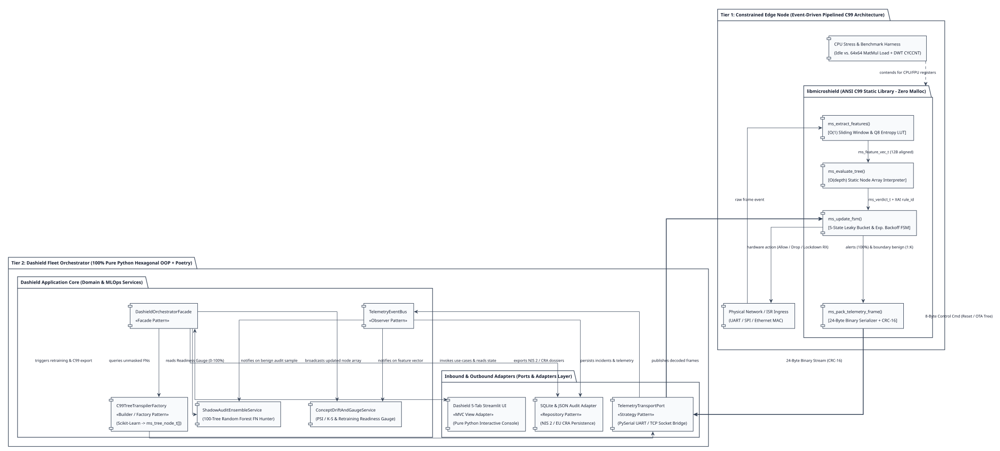
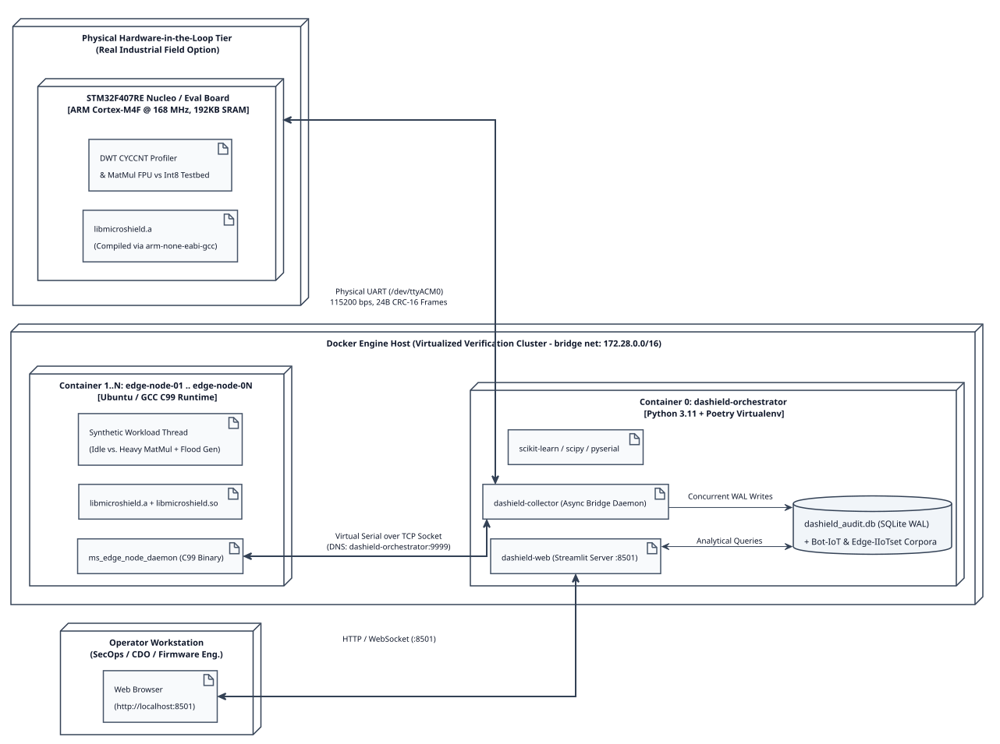
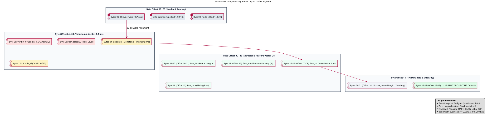
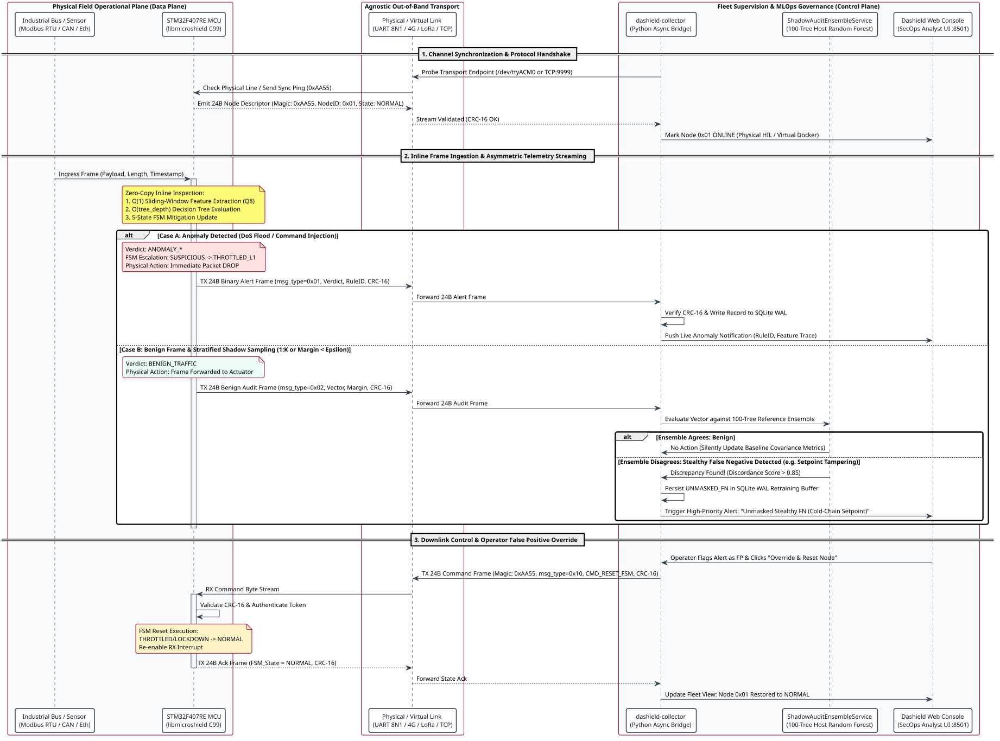

# 3. Design Specification

This chapter formalizes the architectural design, deployment topology, communication protocols, and internal micro-engine specifications for the **MicroShield** system, adhering strictly to top-down software engineering principles.

---

## 3.1 Global Topology & Component Architecture

The MicroShield architecture follows a Dual-Tier Asymmetric paradigm, dividing responsibilities between resource-constrained edge nodes and an auxiliary supervision suite.

  
*(Click on the diagram to open the full-resolution vector graphic in a new tab)*  
*Figure 3.1: Global component breakdown showing libmicroshield embedded edge core interacting with the Python Dashield supervision suite.*

---

## 3.2 Deployment & Container Topology

Field deployment integrates bare-metal microcontrollers with containerized supervisor nodes running Docker Compose environments.

  
*(Click on the diagram to open the full-resolution vector graphic in a new tab)*  
*Figure 3.2: Deployment topology illustrating STM32F407RE hardware-in-the-loop connection via UART to the monitoring gateway.*

---

## 3.3 Telemetry Protocol & Binary Framing

To satisfy real-time constraints and minimize communication overhead on constrained industrial buses, inter-tier communication relies on a deterministic 24-byte binary framing protocol.

  
*(Click on the diagram to open the full-resolution vector graphic in a new tab)*  
*Figure 3.3: 32-bit aligned binary frame layout representing the exact 24-byte telemetry structure.*

### 3.3.1 Binary Frame Specification Table

| Offset (Hex) | Field Name | Size | Data Type | Description & Semantics |
| :--- | :--- | :--- | :--- | :--- |
| **0x00 - 0x01** | `sync_word` | 2 Bytes | `uint16_t` | Magic synchronization header (`0xAA55`) |
| **0x02** | `msg_type` | 1 Byte | `uint8_t` | Message class (`0x01`=Alert, `0x02`=Shadow Audit) |
| **0x03** | `node_id` | 1 Byte | `uint8_t` | Identifier of the generating edge node (`0x01..0xFF`) |
| **0x04 - 0x07** | `seq_ts` | 4 Bytes | `uint32_t` | Monotonic millisecond timestamp / sequence counter |
| **0x08** | `verdict` | 1 Byte | `uint8_t` | Classification result (`0`=Benign, `1..3`=Anomaly severity) |
| **0x09** | `fsm_state` | 1 Byte | `uint8_t` | Current FSM mitigation tier (`0`=Normal .. `4`=Lockdown) |
| **0x0A - 0x0B** | `rule_id` | 2 Bytes | `uint16_t` | Matched CART decision tree rule identifier / leaf ID |
| **0x0C - 0x0F** | `feat_iat` | 4 Bytes | `uint32_t` | Inter-arrival time delta in microseconds ($\Delta t$) |
| **0x10 - 0x11** | `feat_len` | 2 Bytes | `uint16_t` | Raw frame length in bytes |
| **0x12** | `feat_ent` | 1 Byte | `uint8_t` | Normalized Shannon byte entropy in Q8 fixed-point format |
| **0x13** | `feat_rate` | 1 Byte | `uint8_t` | Sliding-window packet frequency accumulator |
| **0x14 - 0x15** | `aux_meta` | 2 Bytes | `uint16_t` | Auxiliary decision margin or command payload argument |
| **0x16 - 0x17** | `crc16` | 2 Bytes | `uint16_t` | ITU-T CRC-16-CCITT checksum (Polynomial `0x1021`) |

  
*(Click on the diagram to open the full-resolution vector graphic in a new tab)*  
*Figure 3.4: UART handshake and asynchronous telemetry streaming sequence.*

