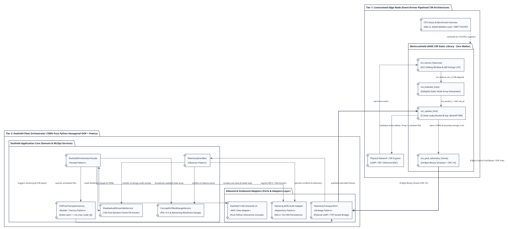
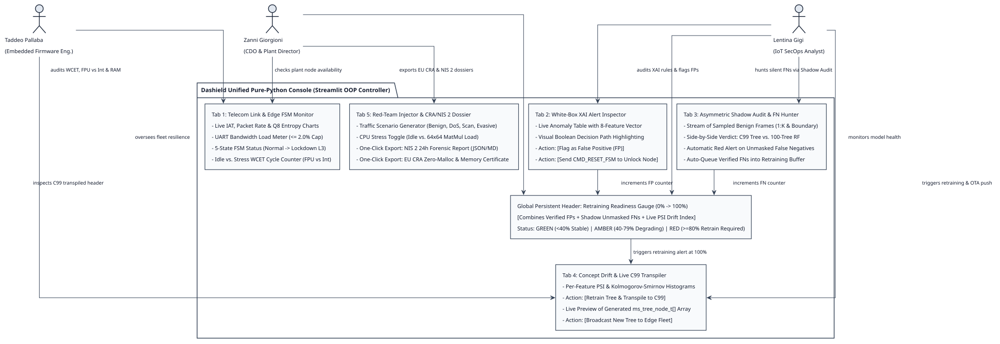
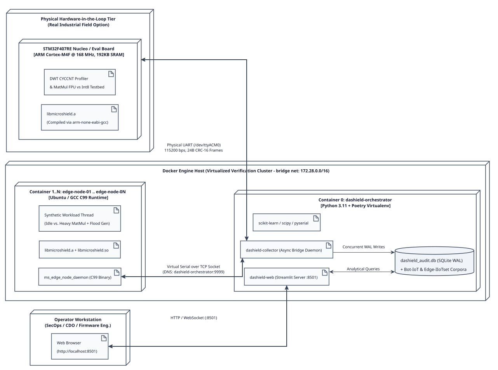

# Chapter 3: Architectural, Detailed & Infrastructure Design

---

## 3.1 Architectural Style, Nominal- vs. Effective-Bound Translation & Component Topology

Designing a cyber-physical Intrusion Detection System (IDS) that spans bare-metal/RTOS microcontrollers and enterprise Security Operations Center (SOC) analytics requires resolving an inherent tension between **market value propositions** during an industrial digital transformation process and **hard real-time embedded systems engineering**.

### 3.1.1 The Dichotomy Between Nominal Market Claims and Effective Worst-Case Engineering Bounds

When industrial organizations undergo a digital transformation of legacy Operational Technology (OT) infrastructures, decision-makers demand security solutions that introduce **nominally "Zero"** operational friction: *Zero Latency* (no delay on physical actuation loops), *Zero Memory* (deployable on existing microcontrollers without hardware expansion), and *Ultra-Low-Power* (negligible energy drain). While these nominal terms serve as powerful market value propositions to emphasize non-intrusiveness, physical computing systems cannot operate in zero time, zero space, or zero energy.

In rigorous hard real-time engineering, this dichotomy between **nominal** and **effective (real)** metrics is resolved by defining "Zero" as a **strict, mathematically and empirically guaranteed Worst-Case Bound**—the ceiling that the software guarantees never to exceed under any operational or adversarial load. Table 3.1 formalizes the mapping between the nominal market value proposition and the effective worst-case engineering bounds of `libmicroshield` (whose empirical verification under stress is detailed in **Appendix A**).

| Nominal Value Proposition (Market / Executive Emphasis) | Strategic Meaning in Digital Transformation | Effective Engineering Reality (Hard Real-Time Worst-Case Bound) | Guaranteed Worst-Case Ceiling & Verification Protocol |
| :--- | :--- | :--- | :--- |
| **"Zero Latency"** *(Sub-Frame Deterministic Execution)* | Inline packet inspection never delays safety-critical control tasks or causes RTOS scheduler starvation. | **Bounded Worst-Case Execution Time (`WCET`) & Near-Zero Jitter:** Feature extraction executes in `O(1)` and tree traversal executes in `O(tree_depth)` (`D <= 8`). Effectively, worst-case execution requires a tiny fraction of a single byte's transmission window on a standard `115.2 kbps` fieldbus (`~86.8 us`), with execution jitter bounded below `20 CPU clock cycles`. | **`WCET <= 1,500 clock cycles`** per frame (`<= 8.9 us` on **STM32F407RE** at `168 MHz`; `<= 18.7 us` at `80 MHz`), with **Jitter `< 20 cycles`**, empirically validated both at idle and under heavy CPU contention (**see Appendix A**). |
| **"Zero Memory"** *(Zero Dynamic Heap & Micro-Static Ceiling)* | The library requires zero RAM upgrades on legacy MCUs and is immune to memory leaks over multi-year uptimes. | **Literal `0 Bytes` Dynamic Heap (`malloc`-free) & Bounded Static Footprint:** While static memory cannot be zero, dynamic heap allocation is literally `0 Bytes` (`0 calls` to `malloc`/`free`), eliminating heap fragmentation. All state resides in fixed compile-time `.bss` structures and naturally aligned `12-byte` feature vectors. | **Dynamic Heap: `0 Bytes`** (verified via ELF symbol table scan). **Static RAM Ceiling (`.bss`/`.data`): `<= 128 Bytes`** per interface context (`ms_context_t`). **Worst-Case Stack Ceiling: `<= 96 Bytes`**. **Total Flash Ceiling (`.text` + `.rodata`): `<= 4.0 KB`**. |
| **"Ultra-Low-Power"** *(Sub-Microjoule Inspection & Interrupt-Gated Sleep)* | Security inspection does not exhaust power budgets or induce thermal throttling in sealed field enclosures. | **Worst-Case Energy-per-Frame Ceiling & `WFI` Sleep Maximization:** Active energy per frame is bounded by `E_max = V_DD * I_run * WCET`. By minimizing active cycle counts and disabling receive interrupts (`RXNE IE = 0`) during Level-3 flood lockdowns, the MCU maximizes residency in low-power *Wait-For-Interrupt* (`WFI`) Sleep Mode. | **Worst-Case Active Energy `< 1.0 uJ` per frame** on STM32F407RE (`3.3V * 35mA * 8.5us = 0.98 uJ`). Preserves **`>= 99.1%` MCU Sleep Mode residency** (`< 2.5 mA` vs. `35 mA` active) under nominal loads, and **`100%` sleep residency** during flood lockdowns. |

*Table 3.1: Resolution of the dichotomy between nominal market value propositions and effective hard real-time worst-case engineering bounds.*

---

### 3.1.2 Comparative Evaluation of Architectural Styles

No single monolithic architectural style can simultaneously satisfy microsecond worst-case bounds on a microcontroller and interactive, data-intensive MLOps governance on a fleet supervision server. Table 3.2 evaluates canonical software architectural patterns against MicroShield's dual-tier requirements (`FR-01..12`, `NFR-01..08`).

| Architectural Style | Core Mechanism | Suitability for Tier 1 (`libmicroshield` C99 Edge) | Suitability for Tier 2 (**`Dashield`** Python Host) | MicroShield Adoption Verdict |
| :--- | :--- | :--- | :--- | :--- |
| **Pure Layered Architecture** | Strict hierarchical call stack (Presentation -> Business -> Persistence -> Hardware). | **Partially Suitable:** Clean separation between HAL, Feature Extractor, and Tree Evaluator, but deep call stacks increase function-call overhead if not inlined. | **Insufficient Alone:** Traditional layering tightly couples UI rendering to database schemas, hindering pluggable transport adapters (Physical UART vs. Docker TCP Socket). | **Adopted with Flat Inlining on Tier 1; Replaced by Hexagonal on Tier 2.** |
| **Object-Based / OOP Architecture** | Encapsulation of state and behavior into polymorphic classes with dynamic dispatch (`vtables`). | **Rejected on Edge:** Dynamic polymorphism (`vtables` / function pointer indirection) defeats compiler branch prediction and violates strict WCET analyzability on MCUs. | **Ideal on Host:** Python 3 OOP provides clean encapsulation for MLOps pipelines, Shadow Auditing ensembles, and stateful multi-tab view controllers. | **Strictly Rejected on Tier 1 (C99); Adopted as Primary Paradigm on Tier 2 (Python).** |
| **Event-Driven / Reactive Pipeline** | Asynchronous or interrupt-triggered processing of discrete data frames through deterministic stages. | **Ideal on Edge:** Matches physical packet arrival interrupts (ISRs) and deterministic Finite-State Machine (FSM) transitions (`O(1)` -> `O(depth)` -> `FSM`). | **Ideal for Telemetry Ingestion:** Decouples incoming 24-byte UART frames from downstream consumers (Alert Store, Shadow Auditor, Drift Monitor) via an Event Bus. | **Adopted across Both Tiers (Synchronous Pipeline on Edge; Observer Event Bus on Host).** |
| **Shared Dataspace (Blackboard)** | Multiple independent workers read/write concurrently to a central shared memory repository. | **Rejected on Edge:** Concurrent shared-memory locking introduces mutex contention, priority inversion, and unbounded blocking times in RTOS tasks. | **Partially Suitable:** Useful only at the persistence boundary (`SQLite WAL` shared between collector daemon and web console). | **Adopted Narrowly for Host Persistence (`SQLite WAL` Repository).** |
| **Hexagonal (Ports & Adapters)** | Domain logic sits at the center, isolated from external I/O (serial links, databases, UI) via explicit Ports and pluggable Adapters. | **Over-Engineered for C99:** Excessive abstraction layers bloat Flash footprint, though the C99 API naturally acts as a pure, hardware-agnostic port. | **Ideal on Host:** Allows **`Dashield`** to switch seamlessly between a real **STM32F407RE** board (`/dev/ttyACM0`) and $N$ virtualized Docker C99 nodes (`TCP Socket`) without changing a single line of domain code. | **Adopted as Master Architecture for Tier 2 (**`Dashield`**).** |

*Table 3.2: Analytical evaluation and justification of architectural styles across the Edge and Host tiers.*

---

### 3.1.3 Master Architectural Topology: Asymmetric Dual-Tier Hybrid Design

Based on the trade-off analysis in Table 3.2, MicroShield adopts an **Asymmetric Dual-Tier Hybrid Architecture**, illustrated in Figure 3.1:

1. **Tier 1 — Core Embedded C99 Library (`libmicroshield`):** Engineered as an **Event-Driven, Zero-Allocation Synchronous Pipeline**. Every incoming frame triggers a deterministic four-stage cascade:
   * `ms_extract_features()`: Constant-time `O(1)` update of circular sliding registers and Shannon entropy calculation (evaluated empirically against hardware floating-point in **Appendix A**).
   * `ms_evaluate_tree()`: Bounded `O(tree_depth)` traversal of a static array of decision nodes (`ms_tree_node_t[]`), outputting both the threat class and the glass-box `matched_rule_id`, while flagging boundary-adjacent benign frames (`is_boundary_sample = 1`).
   * `ms_update_fsm()`: A 5-state **Leaky Bucket + Binary Exponential Backoff Finite-State Machine** that escalates protection from single-frame drops (`SUSPICIOUS`) to temporary throttling (`THROTTLED_L1`), exponential quarantine (`QUARANTINED_L2`), and full hardware receive-interrupt lockdown (`LOCKDOWN_L3`).
   * `ms_pack_telemetry_frame()`: A constant-time binary codec that serializes anomaly alerts (`100%`) and stratified benign shadow samples (`1:K` + boundary frames) into compact `24-byte` frames protected by a `CRC-16-CCITT` checksum.
2. **Tier 2 — `Dashield` Fleet Supervision & MLOps Suite:** Engineered as a **Unified Pure-Python Hexagonal (Ports & Adapters) & Observer OOP Architecture**. Unifying the entire host stack—from low-level serial ingestion and Scikit-Learn MLOps pipelines to the stateful multi-tab presentation layer—within a single object-oriented language eliminates cross-language Inter-Process Communication (IPC) serialization overhead and guarantees type-model consistency across the domain boundary. At its core sits the `DashieldOrchestratorFacade`, which coordinates the `TelemetryEventBus`, the `ShadowAuditEnsembleService` (a 100-tree Random Forest that hunts silent False Negatives), the `ConceptDriftAndGaugeService`, and the `C99TreeTranspilerFactory`.

[](../../puml/des-01-architecture-components.svg)
*(Click on the diagram to open the full-resolution vector graphic in a new tab)*  
*Figure 3.1: Master UML Component Diagram illustrating the Event-Driven C99 pipeline on Tier 1 (`libmicroshield`) and the Hexagonal Ports-and-Adapters OOP architecture of **`Dashield`** on Tier 2.*

---

### 3.1.4 Intrinsic Glass-Box Interpretability, Hybrid Drift Theory & Top-Down UX Design

Two foundational theoretical principles govern the human-computer interaction design of **`Dashield`**:

1. **Intrinsic (Ante-Hoc) Glass-Box Interpretability vs. Post-Hoc XAI (Rudin, 2019) [1]:**
   In contemporary machine learning literature, a sharp epistemological distinction exists between *Post-Hoc Explainable AI (XAI)*—where secondary approximation algorithms such as SHAP or LIME attempt to reconstruct why an opaque black-box neural network made a decision—and *Intrinsically Interpretable Glass-Box Models* (such as CART Decision Trees), which are self-explanatory by mathematical construction. As demonstrated by Rudin (2019) [1], post-hoc approximations are computationally expensive and frequently unfaithful to the underlying model mechanics. MicroShield deliberately rejects black-box classifiers and post-hoc XAI overhead: because `libmicroshield` evaluates a shallow boolean Decision Tree directly over physical telecom metrics, every classification is **natively and deterministically transparent (*ante-hoc interpretable*)**, exposing the exact conjunction of physical threshold splits traversed (`matched_rule_id`).
2. **Hybrid Concept Drift Detection & The Retraining Readiness Index (Gama et al., 2004; Siddiqi, 2006) [2, 3]:**
   To determine objectively when the static tree deployed across the microcontroller fleet has become obsolete and requires retraining, **`Dashield`** implements a **Hybrid Drift Detection Policy** that synthesizes two complementary paradigms from statistical learning theory:
   * *Supervised Error-Rate Monitoring (Gama et al., 2004 [2]):* Tracks confirmed classification failures—specifically operator-flagged False Positives (`N_FP`) and Shadow-Audited False Negatives (`N_FN`).
   * *Unsupervised Covariate Shift Monitoring (Siddiqi, 2006 [3]):* Tracks shifts in the underlying input feature distribution `P(X)` via the **Population Stability Index (`PSI`)**, where literature establishes `PSI >= 0.10` as moderate shift and `PSI >= 0.20..0.25` as the critical action threshold requiring model reconstruction.
   The `ConceptDriftAndGaugeService` combines these three normalized error and shift ratios into a composite heuristic indicator—the **Retraining Readiness Index (`R_index`)** bounded in `[0%, 100%]`:
   ```
   R_index = min(100%,  w_FP * (N_FP / Tau_FP) + w_FN * (N_FN / Tau_FN) + w_PSI * (PSI_max / Tau_PSI))
   ```
   where `Tau_FP = 25`, `Tau_FN = 10` (assigning higher sensitivity to silent evasions unmasked by Shadow Auditing), and `Tau_PSI = 0.20` (Siddiqi's critical shift boundary), with default convex weights `w_FP = 0.25`, `w_FN = 0.45`, `w_PSI = 0.30` (such that any single metric exceeding its critical cap or a combined degradation drives `R_index -> 100%`, triggering a `RED: RETRAIN REQUIRED` state).

[](../../puml/des-03-dashield-ux-tabs.svg)
*(Click on the diagram to open the full-resolution vector graphic in a new tab)*  
*Figure 3.2: Top-down Human-Computer Interaction (HCI) topology of the **`Dashield`** 5-Tab console, mapping stakeholder personas (Taddeo, Lentina, Zanni) to the Hybrid Drift Readiness Gauge and functional views.*

Table 3.3 details the responsibilities and interactive controls of each OOP View Tab within **`Dashield`**.

| Dashield View Component | OOP Controller Class | Target Persona | Real-Time Visualizations & Telemetry Widgets | Interactive Control Actions & System Side-Effects |
| :--- | :--- | :--- | :--- | :--- |
| **Global Header** *(Hybrid Retraining Readiness Gauge)* | `ReadinessGaugeHeaderView` | Lentina Gigi, Zanni Giorgioni | Progress bar (`0%..100%`), color-coded health badge (`GREEN`/`AMBER`/`RED`), live counters of supervised errors (`Verified FPs`, `Unmasked FNs`) and unsupervised shift (`Peak PSI`). | Clicking **`[Jump to Retraining Pipeline]`** navigates directly to Tab 4 with pre-loaded feedback buffers when `R_index >= 80%`. |
| **Tab 1: Telecom Link & Edge FSM Monitor** | `TelecomAndFsmTabView` | Taddeo Pallabà, Zanni Giorgioni | Live time-series of `iat_delta_us`, `pkt_rate_win`, and `payload_entropy`; UART bandwidth utilization meter (`<= 2.0%` of `115.2 kbps`); 5-state FSM badge per node; **Worst-Case Cycle Profiler (Ref. Appendix A)**. | **`[Manual Quarantine Reset]`**: dispatches an 8-byte `CMD_RESET_FSM` command frame over UART/Socket to restore a locked-down node (`LOCKDOWN_L3 -> NORMAL`). |
| **Tab 2: Intrinsic Glass-Box Rule Inspector** | `GlassBoxRuleInspectorTabView` | Lentina Gigi | Filterable incident table showing timestamp, node ID, verdict, and `matched_rule_id`; interactive **Ante-Hoc Boolean Path Visualizer** highlighting the exact C99 threshold splits traversed. | **`[Flag as False Positive (FP)]`**: marks alert as `VERIFIED_FP`, appends vector with label `BENIGN` to retraining store, increments `Readiness Gauge`, and unlocks node FSM. |
| **Tab 3: Asymmetric Shadow Audit & FN Hunter** | `ShadowAuditFnTabView` | Lentina Gigi | Live stream of stratified benign samples (`1:K` + boundary frames where `|val - thr| <= epsilon`); side-by-side comparison between Edge C99 Tree verdict (`BENIGN`) and Host 100-Tree Random Forest verdict. | Automatic highlighting of **`UNMASKED_FN`** discrepancies; **`[Confirm FN & Queue for Retrain]`** feeds evasive vectors into the training corpus and advances the `Readiness Gauge`. |
| **Tab 4: Concept Drift & Live C99 Transpiler** | `DriftAndTranspilerTabView` | Lentina Gigi, Taddeo Pallabà | Per-feature **PSI** and **Kolmogorov-Smirnov (K-S)** drift bar charts against baseline **Bot-IoT / Edge-IIoTset** distributions; confusion matrix, Macro F1-Score, and live syntax-highlighted view of the generated `ms_tree_node_t[]` C99 array. | **`[Retrain & Transpile C99 Tree]`**: runs CART training (`D <= 8`), validates F1 `>= 0.92`, generates `ms_tree_model.h`, and enables **`[Broadcast New Tree to Fleet]`** via UART/Socket. |
| **Tab 5: Red-Team Injector & CRA/NIS 2 Dossier** | `RedTeamAndComplianceTabView` | Zanni Giorgioni, Taddeo Pallabà | Scenario injection status monitor; live EU CRA static memory budget table (`.text`, `.rodata`, `.bss`, stack); NIS 2 incident timeline preview. | **`[Inject Traffic Scenario]`** (Benign, DoS Flood, Scan Probe, High-Entropy Exploit, Stealth Evasion); **`[Toggle Synthetic CPU Stress]`**; **`[Export NIS 2 / CRA Dossier]`**. |

*Table 3.3: Detailed specification of the **`Dashield`** object-oriented multi-tab console and interactive governance controls.*

---

## 3.2 Distributed Infrastructure, Container Topology & Service Discovery

Because MicroShield operates across distributed field nodes and a central supervision server—and must guarantee deterministic reproducibility across both physical testbeds and virtualized clusters—its infrastructure is designed with **Dual-Mode Deployment Symmetry** (Physical Hardware-in-the-Loop vs. Containerized Multi-Node Cluster).

[](../../puml/des-02-deployment-topology.svg)
*(Click on the diagram to open the full-resolution vector graphic in a new tab)*  
*Figure 3.3: UML Deployment Diagram illustrating the dual-mode infrastructure: physical **STM32F407RE** Hardware-in-the-Loop via UART (`/dev/ttyACM0`) alongside the containerized $N$-node Docker Compose topology (`172.28.0.0/16`).*

### 3.2.1 Infrastructural Components & Multiplicity

To fulfill the distributed systems design criteria, Table 3.4 inventories every infrastructural component, its multiplicity (`1` vs. `N`), its runtime execution environment, and its exact architectural role.

| Infrastructural Component | Multiplicity | Execution Technology | Network Location & Isolation | Core Infrastructural Responsibility |
| :--- | :--- | :--- | :--- | :--- |
| **Physical Edge MCU Node (`stm32-edge-hw`)** | `0 .. M` *(Optional HIL)* | **STM32F407RE** (ARM Cortex-M4F @ `168 MHz`, `192 KB` SRAM, `512 KB` Flash) running bare-metal/RTOS C99 firmware. | Field OT cabinet; connected to Host via physical USB-UART bridge (`/dev/ttyACM0` at `115,200 bps`, `8N1`). | Executes `libmicroshield.a` inline on physical frames, runs the hardware `DWT->CYCCNT` cycle profiler (**see Appendix A**), and emits 24-byte `CRC-16` telemetry frames. |
| **Virtualized Edge C99 Daemon Containers (`edge-node-01 .. 0N`)** | `N` *(Default `N = 3` in Docker Compose)* | Docker Container (`debian-slim` + `gcc` C99 runtime) executing compiled binary `ms_edge_node_daemon`. | Isolated Docker Bridge Subnet (`172.28.0.0/16`); no external internet exposure. | Executes the **exact same ANSI C99 `libmicroshield` source code** compiled natively, runs a background POSIX thread generating synthetic CPU contention, processes injected network traffic, and streams 24-byte binary frames over virtual serial sockets. |
| **Async Telemetry Collector & Bridge Worker (`dashield-collector`)** | `1` *(Singleton Daemon)* | Python `3.11+` background worker managed by **Poetry** inside the `dashield-orchestrator` container. | Bound to `0.0.0.0:9999` (TCP Socket bridge for Docker nodes) and `/dev/ttyACM0` (for physical STM32). | Multiplexes incoming 24-byte binary streams from all `N + M` edge nodes, verifies `CRC-16-CCITT` checksums, triggers the `ShadowAuditEnsembleService` on benign samples, and writes validated records to persistent storage. |
| **Transactional Audit & Telemetry Database (`dashield_audit.db`)** | `1` *(Embedded Shared Store)* | **SQLite 3** configured in **Write-Ahead Logging (`WAL`)** mode + curated Parquet/CSV benchmark partitions. | Mounted on persistent Docker volume `/data/dashield_storage` inside `dashield-orchestrator`. | Provides ACID-compliant, zero-configuration concurrent persistence (`1` concurrent writer from `dashield-collector`, multiple concurrent readers from `dashield-web`) for incidents, shadow discrepancies, and `FP`/`FN` feedback vectors. |
| **Supervision Web Server & MLOps Engine (`dashield-web`)** | `1` *(Singleton Server)* | **Streamlit** pure-Python OOP application managed via **Poetry** (`poetry run streamlit run`). | Exposed on host loopback/LAN port `http://localhost:8501` via Docker port forwarding. | Serves the 5-Tab interactive console to human operators, computes live PSI/K-S drift metrics, executes Scikit-Learn CART retraining, transpiles C99 node arrays, and dispatches control commands back to edge nodes. |

*Table 3.4: Inventory, multiplicity, and network distribution of infrastructural components across the MicroShield ecosystem.*

---

### 3.2.2 Network Distribution, Naming Conventions & Deterministic Service Discovery

In a distributed cyber-physical system, components must discover and authenticate communication endpoints deterministically without relying on fragile manual IP configuration:

1. **Containerized Cluster Naming & DNS Service Discovery:**
   Within the `docker-compose.yml` orchestration manifest, all containers attach to a dedicated user-defined bridge network named `microshield_ot_net` (`172.28.0.0/16`). Docker's embedded DNS server (`127.0.0.11`) provides automatic name resolution:
   * The central supervision container is registered under the canonical hostname **`dashield-orchestrator`**.
   * Each edge C99 container is provisioned with a deterministic node identifier (`MS_NODE_ID = 1..N`) and hostname (`edge-node-01`, `edge-node-02`, `edge-node-03`) via environment variables. Upon startup, `ms_edge_node_daemon` resolves `dashield-orchestrator:9999` via standard POSIX `getaddrinfo()` and establishes a persistent full-duplex byte-stream connection that emulates a physical UART wire (`PySerial` `socket://` protocol handler).
2. **Physical Hardware-in-the-Loop (`STM32F407RE`) Auto-Detection:**
   When the physical **STM32F407RE** board is connected via USB ST-Link Virtual COM Port, the Linux udev subsystem maps it to `/dev/ttyACM0` (or `/dev/ttyUSB0`). The `TelemetryTransportPort` in **`Dashield`** implements an automatic discovery probe: if `/dev/ttyACM0` is present and responds with the MicroShield `0xAA55` sync handshake, it attaches a `PhysicalUartTransport` worker alongside the virtualized Docker nodes, allowing physical and simulated nodes to be monitored side-by-side on Tab 1.
